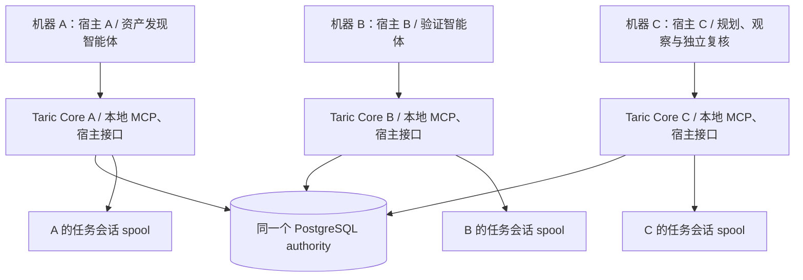

# Taric 面向渗透测试智能体的集成方案

> 版本：2026-10-15 · 依据当前工作区实现（含 `harden-taric-authority-runtime`；API Contract 1.0.0 / Schema v1）。配套阅读：[代码设计](taric-code-design.md)、[API 边界](taric-api.md)、[接入指南](agent-integration.md)、[多主机运行手册](multi-host-authority-runbook.md)、[PostgreSQL 运行时验证](postgres-runtime-readiness.md)。本文描述可集成的能力与宿主实施要求，实际启用状态以部署诊断和匹配当前构建的验证证据为准。

## 目录

1. [方案概述](#1-方案概述)
2. [总体架构](#2-总体架构)
3. [Taric 结构性风险防护（核心亮点）](#3-taric-结构性风险防护核心亮点)
4. [身份与接入设计](#4-身份与接入设计)
5. [状态黑板设计](#5-状态黑板设计)
6. [核心工作流](#6-核心工作流)
7. [并发执行与冲突控制](#7-并发执行与冲突控制)
8. [Artifact 原文存储集成](#8-artifact-原文存储集成)
9. [上下文供给策略](#9-上下文供给策略)
10. [长周期大量资产任务能力评估（推演）](#10-长周期大量资产任务能力评估推演)
11. [实施路线（五阶段接入与多主机验收）](#11-实施路线五阶段接入与多主机验收)
12. [边界与注意事项](#12-边界与注意事项)
13. [端到端示例（浓缩时序）](#13-端到端示例浓缩时序)

## 1. 方案概述

### 1.1 背景与目标

智能渗透测试系统作为 Taric 的宿主应用，采用**规划者 + 执行者 + 观察者**的多智能体协作模式：

- **规划者智能体（Planner）**：仅负责规划，不执行具体任务——产出任务分解、目标资源、验收标准与风险预算。
- **执行者智能体（Executor，可多实例并发）**：根据自身角色与能力认领规划产出的任务，执行并反馈结果；并发数量由宿主的并发资源池决定，只调度相互无冲突的任务。
- **观察者智能体（Observer）**：持续观察规划者与执行者的异常行为，并对异常进行纠偏。

本方案的目标是把 **Taric 用作三类智能体共享的状态黑板**：任务归属、执行状态、观察结果、证据引用、结论沉淀、异常记录与恢复点全部经 Taric 同步与持久化；同时利用 Taric 的任务会话 spool **存储渗透测试过程中的 Artifact 原始数据**（HTTP 交换、截图、日志、抓包、扫描器输出等），支撑大量资产的长周期持续渗透测试。

部署 PostgreSQL 并显式启用多主机模式后，这套黑板可由**分布在不同机器上的多个智能渗透测试宿主应用**共同使用。例如，宿主 A 组织资产发现，宿主 B 组织验证，宿主 C 组织独立复核；它们在同一 Engagement 内共享授权范围、资源版本、覆盖状态、任务和恢复记录。宿主可以使用不同模型与工具，但必须接入同一套 Taric 契约与治理路径。跨机协作通过重新查询、提案治理和任务租约完成，不要求模型之间共享完整会话历史。

### 1.2 部署形态与边界

- **单机模式（默认）**：`single_host_sqlite` profile 使用持久 SQLite WAL authority 与本地 Artifact spool，无 PostgreSQL 依赖，适合一台机器上的宿主与多个 worker。
- **多主机模式（显式启用）**：`multi_host_authority` profile 使用同一个 PostgreSQL authority；各机器运行 Taric Core，并接入各自宿主的模型、工具与本地 spool。共享范围由 Engagement 与 principal 权限共同约束，不自动跨 Engagement 分享。
- **Taric 只做状态与记忆**：不运行模型、不启动/调度 agent、不执行目标系统操作、不发放高风险动作授权、不管理凭据生命周期。agent 调度、工具调用、动作授权、HITL 交互全部由宿主系统负责。
- **零模型直写**：三类智能体（都是 LLM agent）对权威记忆只有"提案权"；权威写入、任务认领、工具执行、Artifact 落盘由宿主运行时以 host/operator 身份完成。观察者的纠偏同样是"提案 + 建议"，由宿主强制执行。

多主机模式已接入与 SQLite 共用的异步 Core 治理实现。仓库保存了十二类运行时场景通过的[PostgreSQL 验证报告](benchmarks/postgres-runtime-v1.json)，默认部署仍保持 PostgreSQL runtime disabled；只有显式配置、构建/schema/policy 匹配的验证报告和当前数据库/租约健康检查同时通过，才可启用。这份报告是指定环境的功能证据，真实宿主跨机协作与容量仍需按 §11 单独验收。

## 2. 总体架构

### 2.1 单机模式

```text
┌────────────────────────── 智能渗透测试系统（宿主应用）──────────────────────────┐
│                                                                                │
│  ┌──────────┐   ┌──────────┐ ┌──────────┐ ┌──────────┐      ┌──────────────┐  │
│  │ 规划者    │   │ 执行者 1  │ │ 执行者 2  │ │ 执行者 N  │      │   观察者      │  │
│  │ (Planner)│   │(Executor)│ │(Executor)│ │(Executor)│      │  (Observer)  │  │
│  └────┬─────┘   └────┬─────┘ └────┬─────┘ └────┬─────┘      └──────┬───────┘  │
│       │ MCP 模型工具  │ MCP 模型工具 │            │ MCP 模型工具      │ MCP/Reviewer│
│  ─────┴─────────────┴────┬────────┴─────────────┴──────────────────┴─────     │
│                     宿主运行时（非 LLM，权威执行层）                              │
│       · agent 调度器（并发资源池、无冲突任务分派）                                │
│       · 渗透工具执行器（nmap/nuclei/浏览器/curl…，Taric 外部）                    │
│       · 动作授权与 HITL 策略（含 high-risk 审批）                                 │
│       · 以 host/operator principal 调用 Core 全量操作                            │
└───────────────────────────────────┬────────────────────────────────────────────┘
                                    │ 内嵌 CoreService / CLI / adapter RPC
                            ┌───────▼────────────────────────────┐
                            │        Taric Core（单机）           │
                            │  SQLite WAL authority（权威状态）    │
                            │  Context Pack / 治理 / 覆盖 / 审计  │
                            │  Artifact 任务会话 spool（原文字节） │
                            │  Markdown 投影 + 本地 Git checkpoint│
                            └────────────────────────────────────┘
```

要点：

1. **三类智能体都不直接接触 authority**：经 MCP stdio 只能使用 6 个模型工具（`context.query`、`resource.query`、`evidence.query`、`proposal.submit`、`checkpoint.propose`、`action.recommend`）；观察者额外经宿主适配通道持有 reviewer 身份调用 `review.submit`。
2. **受信任的非 LLM 运行时调用 Core 写入路径**：任务认领、观察捕获、Artifact 上传、checkpoint 提交和动作结果由相应 host 能力完成；L1 admission 与 L2 promotion 使用各自授权的 operator/writer 能力。普通 host 和 reviewer 不能直接晋升 L2。
3. **黑板同步靠 Taric 的钉住快照读**：每个 Context Pack 固定在一个 `read_seq` 上，避免读到半更新状态；不同智能体独立查询时序列可以不同。需要共同基线的工作流必须显式固定受支持的读取序列/快照，最新提交则通过新查询或 resume delta 获取。

### 2.2 PostgreSQL 多主机模式



每台机器的受信任 Core 连接同一个 PostgreSQL authority（同一目标数据库/schema）；模型仅通过受限工具访问。MCP stdio 和现有 adapter Unix socket 是本机接入通道，跨机共享由 Core 到 PostgreSQL 的连接完成，不把它们当作现成的远程 RPC 服务。

| 共享对象 | 多主机效果 | 宿主需要完成的工作 |
|---|---|---|
| Scope、资源/修订、观察、覆盖与结论 | 同一 Engagement 下按权限读取共同状态，减少重复调查 | 刷新 Context Pack、消费增量；遵循 L0/L1/L2 可见性 |
| WorkItem、WorkRun、Attempt | 多宿主竞争同一任务时至多一个有效租约；代次隔离旧执行者写入 | 选择待办、认领/续租、启动 worker、过期后接管 |
| Checkpoint、ActionIntent、恢复记录 | 新宿主可在接管后检查历史进度、未决动作与当前前提 | 校验并重建当前 Attempt 的恢复边界，处理外部动作对账 |
| Proposal、Review、L1/L2 状态 | 可将提交、独立复核和授权晋升分布到不同宿主 | 配置独立身份、固定证据输入和 writer 权限 |
| 版本、审计、幂等、outbox 与水位 | 提交顺序、冲突和派生状态可统一追溯 | 处理冲突/重试、监控滞后、执行备份恢复 |
| Artifact 目录、哈希、证据引用 | 共享证据元数据与归属 | 原文字节的远程访问、文件路由和备份另行落实（§8.4） |

PostgreSQL 统一权威状态和提交顺序，各宿主可并行运行模型与目标工具。当前实现对 authority schema 的写事务使用统一事务锁，并不意味着数据库写入能力随宿主数量线性增长。Taric 也不提供自动 worker 调度、通用宿主消息总线或目标工具执行；这些职责仍属于宿主系统。

## 3. Taric 结构性风险防护（核心亮点）

长周期多智能体渗透测试有四类典型失效：**上下文溢出导致幻觉与偏差、漏报、误报、任务异常终止**。其中一部分来自**记忆丢失、状态错乱、模型直写**。Taric 通过持久权威状态、事务、权限、版本和恢复契约约束这些失效，使冲突与不满足恢复前提的情况可诊断、可阻塞。具体保证以相应接口和部署条件为限；它不保证消除模型误判、存储故障或所有中断损失。

### 3.1 防"记忆丢失"：状态在权威层，不在任何 agent 的会话里

| 机制 | 结构性保证 |
|---|---|
| SQLite / PostgreSQL 权威层 | 持久保存已提交的任务、观察、证据引用、覆盖与结论；PostgreSQL 模式供多个机器共享。故障后以事务、存储健康与恢复校验结果为准，备份和文件耐久性仍需部署保障 |
| 覆盖矩阵（CoverageCell） | "测过什么/没测什么"是**可查询的持久状态**而非模型回忆；`not_tested`/`blocked` 在白名单投影与报告中强制可见（发布门槛） |
| 阴性结果有界保存 | "未复现/被拦截"同样入库并带条件与限制，不会被后续上下文挤出而丢失，也不会被夸大为普遍不存在 |
| Checkpoint + resume delta | 执行者恢复时只取 checkpoint 之后的增量；上下文规模与任务时长**解耦** |
| Artifact 任务会话 spool | 原始证据字节持久保存并全程哈希校验；任何结论随时可对照原始字节复核 |

效果：漏报与偏差中"模型忘了 / 历史装不下"这一根因被消除——记忆问题转化为对权威层的查询问题。

### 3.2 防"状态错乱"：并发与故障下的确定性

| 机制 | 结构性保证 |
|---|---|
| 钉住 read_seq 快照读 | 所有智能体读到的都是某一完整提交序列的状态，绝不混入并发写入的半更新数据 |
| 单写者短事务 + CAS + PatchSet 冲突队列 | 并发写同一实体时至多一方成功；事实字段冲突保留双候选进 Conflict 队列，绝不 last-write-wins 静默覆盖 |
| 租约 + 心跳 + generation fencing | 对绑定 WorkRun 的受保护写入验证当前 owner/租约/代次；旧代写入被拒绝或按接口隔离，保留原始归属。该保证不撤销宿主已执行的外部动作 |
| 前提失效检测 | resume 发现 scope/依赖/授权引用变化时返回 `blocked/replan_required`，拒绝在错误前提上续跑 |
| 哈希链审计 + operation marker + doctor/reconcile | 每次状态迁移可验证；派生层漂移可诊断、可幂等修复；权威漂移**阻塞写入**而非带病运行 |
| authority 原子事务 + 发布标记 + 幂等键 | authority 状态与审计等同事务提交；Artifact 文件与目录发布以标记和校验恢复，不暴露未验证内容；相应状态 API 的合法重试不产生重复转移 |

效果："多执行者互相踩踏"与"崩溃后状态不一致"这一根因被消除——异常终止变成可恢复事件，错乱变成被拦截的冲突或可见的 Conflict 记录。

### 3.3 防"模型直写"：幻觉进不了事实层

| 机制 | 结构性保证 |
|---|---|
| 零模型直写 | planner/executor/observer 全部只有提案权（L0）；admission、权威写入、任务认领、工具执行、Artifact 落盘全部由宿主（非 LLM）完成 |
| 观察走宿主 | `capture.observation` 为 host-only；执行者模型对"观察到了什么"无写入权，幻觉无法变成 Observation |
| 分离 L1 准入与 L2 晋升 | `admission.evaluate` 只做结构、引用、归属、来源和版本检查；`admission.promote_l2` 在固定提案/证据输入上重算 evidence/freshness/independence/risk 等硬门，缺少晋升条件则拒绝 |
| 证据钉版本 | 评审时按 id+version 钉住证据快照；已召回、跨 Engagement、丢失的证据拒收 |
| L1 隔离 + L2 独立复核 | 机审候选默认不进普通召回；高危 Finding 需独立（可异构）reviewer；`accept=true`、自审、同模型同提示一致全部无效（投毒回归测试固化） |
| 字段白名单 + 敏感剥离 | 模型上下文只含白名单字段；checkpoint 契约剥离 reasoning/chain_of_thought 等隐藏推理字段 |

效果：幻觉型误报的传播半径被封死在 L0/L1 隔离区。幻觉型 Finding 有三条确定性"死法"：无证据引用 → evidence 硬门拒；伪造引用 → 引用完整性校验拒；证据过期 → freshness 硬门拒。

### 3.4 风险转变总览

| 状态层根因 | 传统多智能体的表现 | Taric 结构性对策 | 失效模式的转变 |
|---|---|---|---|
| 记忆丢失 | 长任务后忘测过什么 → 漏报；历史塞进上下文 → 溢出 | 权威层 + 覆盖矩阵 + checkpoint/resume delta + Artifact spool | "忘了" → 可查询的状态；溢出 → fail closed + 增量供给 |
| 状态错乱 | 并发互踩覆盖、崩溃后状态不一致、错误前提续跑 | 快照读 + CAS/fencing + 前提检测 + doctor/reconcile | 错乱 → 被拦截的冲突/可见漂移；终止 → 可恢复事件 |
| 模型直写 | 幻觉写入共享记忆 → 误报扩散、结论污染 | 提案制 + 宿主代写 + 五硬门 + L1 隔离 + 独立复核 | 污染 → 止步 L0/L1 的隔离候选 |

**一句话**：Taric 把四类风险从"不可见、不可控的模型失效"转变为"**可观测、可拦截、可恢复的状态问题**"。残余风险（模型单次推理的注意力遗漏、同源误读、复核吞吐等）属于运营层，其推演与宿主前提见 §10。

## 4. 身份与接入设计

### 4.1 Principal 分配表

| Principal ID | Role | 绑定 | Capabilities | 接入通道 | 说明 |
|---|---|---|---|---|---|
| `planner` | model | engagement | read, propose | MCP stdio | 只规划：读上下文、提交 WorkItem/假设/纠偏提案 |
| `executor-1..N` | model | engagement | read, propose | MCP stdio（每实例一个进程） | 读任务上下文、提交观察提案/进度建议/动作建议 |
| `observer` | model + reviewer（双通道） | engagement | read, propose / read, review | MCP stdio + 宿主 reviewer RPC | 读全局状态、检测异常、评审提案、提交纠偏提案与建议 |
| `pentest-host` | host | engagement | read, propose, work, checkpoint, action, content；原文另授 content_read | 宿主内嵌 CoreService | 任务认领/续租/重认领、观察捕获、Artifact 存取、checkpoint 提交、动作决定/结果 |
| `operator` | operator | engagement | read, propose, admit, audit, operator, content, content_read | CLI / 宿主运维面 | Engagement 初始化、admission、审计诊断、会话绑定、原文读取 |
| `canonical-writer` | writer（或具备 writer 能力的 operator） | engagement | writer | 受信任宿主治理通道 | 显式调用 `admission.promote_l2`；与普通 host、reviewer 身份分离 |

约束：

- 每个智能体使用**独立的 `TARIC_PRINCIPAL_ID`**，保证审计事件、幂等键、Context cursor 与提案 provenance 可归属到具体 agent。
- 观察者需要两个身份：`model` 身份走 MCP 做日常巡查；`reviewer` 身份仅用于 `review.submit`（reviewer_id 必须等于已验证 principal id，防止伪造）。两个身份能力不同，不要混用。
- 智能体**不得**持有 host/operator/writer 凭据。多主机可以存在多个受信任 Core 写入实例，由共同 authority 的事务、版本和权限检查协调；不存在模型绕过 Core 直写数据库的通道。
- 多主机使用全局可区分的身份，例如 `host-a`、`host-b` 与 `host-a/executor-1`、`host-b/executor-1`。`TARIC_HOST_ID` 是部署标识，任务 owner 取自经过验证的 host principal；仅修改请求中的 `host_id` 不会转移归属。部署时应将本机 host principal 与部署标识一致配置。

### 4.2 单机部署配置

| 项 | 值 | 说明 |
|---|---|---|
| authority profile | `single_host_sqlite`（默认） | 显式省略 PostgreSQL 配置即生效 |
| `TARIC_DB` | `./data/taric.sqlite` | 三类 agent 的 MCP 进程与宿主内嵌 Core 指向同一文件 |
| `TARIC_CONTENT_ROOT` | `./data/content` | Artifact spool 根；任务会话根必须位于其内 |
| `TARIC_ENGAGEMENT_ID` | 本次 Engagement UUIDv7 | 所有 principal 统一绑定，防跨 Engagement 读写 |
| MCP 启动 | 每个智能体一个 `taric-mcp` stdio 子进程 | 分别设置 `TARIC_PRINCIPAL_ID=planner\|executor-N\|observer` |
| 原文读取 | 宿主/observer 经 `content_read` capability | 智能体模型侧默认永远只见元数据 |

单机入口须统一解析到同一持久 SQLite authority，避免各自创建独立副本；受信任宿主可统一提供本机 Core 接入通道。当前 Core 和持久化接口均为异步，构造、调用与关闭需要 `await`；底层 SQLite 仍是单写者，同步文件/数据库工作和大导出可能占用调用进程，应通过有界查询与独立维护进程控制（见 §10.4 前提 8）。

### 4.3 PostgreSQL 多主机配置与启用

所有机器使用兼容的 Core 构建、schema 与 policy，连接同一 PostgreSQL authority。下表中的主机身份、principal 和本地目录需要逐机配置；同一协作项目使用同一个 Engagement UUIDv7。

| 配置项 | 配置要求 |
|---|---|
| `TARIC_AUTHORITY_PROFILE` | `multi_host_authority`，显式选择 PostgreSQL |
| `TARIC_DATABASE_URL` | 指向共同的 PostgreSQL 服务与目标数据库，由受信任运行时持有 |
| `TARIC_HOST_ID` | 逐机唯一，例如 `host-a` / `host-b` |
| `TARIC_LEASE_MODE` | `server_side`，使用数据库时间判断租约到期 |
| `TARIC_RUNTIME_CONFORMANCE` | 指向与当前执行构建、schema、policy 摘要匹配的通过报告 |
| `TARIC_CONTENT_ROOT` | 当前机器独立、持久的内容根；不因为数据库共享而共用可写 spool |
| `TARIC_ENGAGEMENT_ID` | 协作宿主绑定同一项目，权限由已验证 principal 约束 |
| `TARIC_PRINCIPAL_ID` / `TARIC_PRINCIPAL_ROLE` | 按实际进程身份设置；模型 MCP 进程保持 model 身份，host 能力经宿主受信任通道提供 |

启用顺序：先部署 PostgreSQL 并由 operator 初始化受支持的 schema；在隔离测试数据库/schema 上完成 live conformance 和恢复验证，生成当前构建的启用报告；再配置各机器并检查真实 authority 的 schema、序列与 lease/fencing 健康，最后接入宿主流量。CLI/MCP 使用 `openRuntimeService` 的共同启用路径；内嵌宿主应复用该入口，而不是绕过启用门直接创建生产 store。

```ts
import { openRuntimeService } from "@taric/core";

// 在受信任宿主进程中读取上述环境/配置；principal 由接入通道验证并绑定。
const service = await openRuntimeService();
try {
  const result = await service.dispatch(operation, verifiedPrincipal, request);
  // 按结构化结果处理成功、版本冲突、授权拒绝或不可用。
} finally {
  await service.close();
}
```

这是调用结构示意，`operation`、`verifiedPrincipal` 和 `request` 由宿主集成提供。连接凭据不能交给模型。服务不可用、报告缺失/不匹配或健康检查失败时保持阻塞，不创建 SQLite 降级副本；恢复 PostgreSQL 后重新检查健康并重试。部署步骤见[本地部署与启用](postgres-local-deployment.md)和[多主机运行手册](multi-host-authority-runbook.md)。仓库 Compose 示例仅绑定本机回环地址，不能原样作为跨机部署；跨机部署需配置受控网络、身份凭据、最小权限和连接保护。

### 4.4 异构宿主的协作接入

自主开发的渗透测试宿主可直接内嵌 Core，或在本机经受认证通道对接；模型仍用受限 MCP 工具。Pi 当前覆盖上下文及 proposal/checkpoint/action/result 生命周期；DeepSeek Harness 原生桥主要覆盖 session 事件；Hermes 覆盖上下文和观察钩子，尚无完整 proposal/checkpoint/action 集成。使用后两者时，完整的认领、续租、检查点、动作结果与恢复循环需由宿主补齐，不能把“可访问共同数据库”视为“完整协作闭环已完成”。版本与边界以[接入指南](agent-integration.md)和[能力清单](../packages/core/src/compatibility.ts)为准。

## 5. 状态黑板设计

### 5.1 黑板分区与 Taric 实体映射

| 黑板分区 | Taric 实体 | 写入方（经谁） | 读取方 |
|---|---|---|---|
| 任务规划区 | `WorkItem`（含 goal/acceptance/risk_budget/目标资源） | planner 提案 → 宿主 admission | 全部 |
| 任务执行区 | `WorkRun` / `Attempt`（owner、lease、generation、状态、task_session_ref） | 宿主 `work.claim/renew/reclaim` | 全部（观察者重点） |
| 观察结果区 | `Observation` / `NegativeObservation` / `ControlObservation` / `AccessDecisionObservation` | 宿主 `capture.observation` / `control.observe` / `access.observe`（依据执行者回传与工具输出） | 全部 |
| 原始证据区 | Artifact（任务会话 spool）+ `Evidence`（引用 content_ref） | 宿主 `artifact.store.begin/append/commit`；Evidence 随观察/提案关联 | 宿主/operator/observer（原文需 content_read）；模型只读元数据 |
| 结论事实区 | `Claim` / `Finding` / `AttackPath` / `Relation` | 执行者或 planner 提案 → admission（L1）；Finding 经独立复核后，由授权 writer 显式 promotion（L2） | 全部（按信任级过滤） |
| 覆盖状态区 | `CoverageCell` | 随观察/阴性结果更新（宿主捕获路径） | planner（补规划）、observer（查缺口） |
| 异常纠偏区 | `Proposal`（拒绝态）/ `Review` / `Conflict` / `ImpactEvent` / `ActionIntent` | observer 评审+纠偏提案、宿主执行 impact/reclaim/动作 | 全部 |
| 恢复区 | `Checkpoint` | 执行者 `checkpoint.propose` → 宿主 `checkpoint.commit` | 执行者（resume）、observer |
| 演进区 | `ResourceRevision` / `PatchSet` | 宿主 `resource.revise/patch/relation/impact`（依据提案） | 全部 |

### 5.2 读写权限矩阵（R=读 W=提案写 H=宿主代写 ✕=不可见）

| 分区 | Planner | Executor | Observer | 宿主运行时 | Operator |
|---|---|---|---|---|---|
| 任务规划区 | R/W | R | R/W | R/H(admission) | R/H |
| 任务执行区 | R | R(自身 Run) | R | R/H(claim/renew/reclaim) | R |
| 观察结果区 | R | R/W | R | R/H(capture) | R/H |
| 原始证据区-元数据 | R | R | R | R/H(store) | R/H |
| 原始证据区-原文 | ✕ | ✕ | R(需 content_read) | H(read) | H(read) |
| 结论事实区-L0/L1 | R(显式 candidate) | R(显式 candidate) | R | R/H | R/H |
| 结论事实区-L2 | R | R | R | R；升级需独立 writer 通道 | R/H（需 writer 能力） |
| 覆盖状态区 | R | R | R | R/H | R |
| 异常纠偏区 | R/W | R/W | R/W+Review | R/H(强制执行) | R/H |
| 恢复区 | R | R/W(propose) | R | R/H(commit/resume) | R |

## 6. 核心工作流

### 6.1 Engagement 初始化与任务会话绑定（operator/宿主，一次性）

```text
1. operator: engagement.init        → 创建 Engagement + Scope（ROE、允许/禁止目标、窗口）
2. operator: artifact.session.bind  → { engagement_id, session_id: "pentest-<engagement短id>",
                                        root: "<TARIC_CONTENT_ROOT>/sessions/pentest-<短id>" }
3. operator: audit.doctor           → 确认 authority/sidecar 健康
4. 宿主: 启动 N 个执行者 MCP 子进程 + planner/observer MCP 子进程（统一 TARIC_ENGAGEMENT_ID）
```

单机单 Engagement 可绑定一个任务会话根，靠 `work_run_id/attempt_id/generation` 区分执行者归属。多主机则由每台宿主创建独立 `session_id`（如 `pentest-<短id>-host-a`）及本地根，避免相同 session 被不同机器绑定到互不可见的文件路径（见 §8.4）。

### 6.2 规划流程（Planner，纯提案）

```text
① planner: context.query（省略 work_run_id，预算约 12000 字符）
   └─ Context Pack 固定 read_seq：Scope/ROE → 覆盖缺口 → L2 资源/关系 → 冲突/过期项 → 待办 WorkItem
② planner: proposal.submit（每任务一个，subject_type: "work_item"）
   content = { kind: "work_item", title, goal, acceptance_criteria[], risk_budget,
               target_resource_refs[], worker_role: "executor-网页|executor-主机|…",
               constraints[]（如低噪音、限速、时间窗）, engagement_id }
   （领域字段按 schema 提交；不传 content.id，canonical UUIDv7 由 Core 分配）
③ 宿主（非 LLM）: admission.evaluate
   ├─ Core 校验结构、引用、归属、来源与版本；宿主另行检查验收、任务语义重复和调度约束
   ├─ 通过 → WorkItem 进入权威任务池（L1）
   └─ 拒绝 → 状态 rejected，planner 可经 proposal.list 查看原因后重新规划
④ planner 持续: resource.query / evidence.query / context.query（新 read_seq）→ 发现覆盖缺口 → 补充提案
```

规划者**不认领任务、不执行工具、不写观察**；它的产出只有 WorkItem/假设/关系提案与规划建议。

### 6.3 任务执行流程（宿主调度 + Executor 认知 + 工具在外部执行）

以执行者 `executor-2` 认领 WorkItem `W-42`（目标资源 `R-api`，无冲突）为例：

```text
调度（宿主，非 LLM）:
  a. 从任务池选择 status=queued 且与在跑任务资源集不相交的 WorkItem
     （并发资源池：N 个执行者 → N 个并发 WorkRun；冲突判定见 §7）
  b. work.claim { work_item_id: W-42, host_id: "pentest-host",
                  agent_id: "executor-2", ttl_ms: 300000,
                  task_session_ref: "pentest-<短id>" }
     → 返回 run_id、attempt_ref、generation、lease_expires_at、read_seq
     （同一 WorkItem 的活跃租约唯一；重复 claim 被拒绝）

执行循环（executor-2 经 MCP）:
  c. context.query { work_run_id: <run_id> }
     → Pack 含 WorkItem 目标/验收/风险预算、R-api 当前版本、相关 L2 观察、
       最近 checkpoint、限制条件；不含未显式请求的 L0/L1 项
  d. action.recommend { target: "https://target/api", method: "GET+FUZZ",
                        rationale: "...", uncertainty: "...", mode: "llm_recommend",
                        evidence_refs: [...], work_run_id, generation }
  e. 宿主策略: action.host-decision
     ├─ 低风险预授权池 → status=authorized（authorized_autonomous），宿主执行工具
     ├─ 高风险 → host_hitl：宿主向审批人请求 → 回传 authorized/denied
     └─ 拒绝 → denied，执行者换路或标记 blocked
  f. 宿主执行工具（Taric 外部），拿到原始输出（HTTP 请求/响应对）

落盘（宿主，host principal）:
  g. artifact.store.begin { payload_kind: "manifest", media_type: "application/json",
          work_run_id, attempt_id, generation,          ← 三者必须齐备的 run 作用域 fence
          child_refs: [<req-artifact>, <resp-artifact>] }   ← 复合捕获：请求/响应各自独立
     （单个大输出：begin{payload_kind:"binary"} → append×N（≤64MiB/块）→ commit）
  h. capture.observation { observation: { kind: "observation", resource_ref: R-api,
          conditions: [...], evidence_refs: [<evidence-id>],
          artifact_refs: [{ content_ref, content_status: "available",
                            integrity_status: "verified", byte_length, content_hash }] },
          work_run_id, generation }
     → Observation 进入权威层（宿主写入，可信来源）

进度与恢复:
  i. executor-2: checkpoint.propose { completed_steps, next_steps,
          observation_refs, negative_results, budget 消耗 }（L0 候选）
  j. 宿主复核租约/引用/工具结果后: checkpoint.commit → 形成可恢复安全边界
  k. 宿主周期性 work.renew（心跳）；任务完成 → 结果状态 completed，回填 WorkItem

结论沉淀:
  l. executor-2: proposal.submit（claim/finding，引用 g/h 的 evidence）
  m. 宿主: admission.evaluate → L1 机审候选（默认不进普通召回）
  n. observer 或独立 reviewer: review.submit（pass，固定 proposal/evidence 输入）
  o. 授权 writer/operator: admission.promote_l2 → 重算硬门 → L2 Finding 或结构化拒绝
```

要点：

- **观察写入走宿主**：`capture.observation` 是 host-only 操作。执行者智能体对"我观察到了什么"只有提案权；宿主依据工具输出执行捕获，避免 LLM 幻觉直写事实层。
- **Artifact 上传必须带 run fence**：`work_run_id + attempt_id + generation` 三要素齐备，Taric 在 authority 事务中验证租约；被 reclaim 的旧代数上传被拒绝，迟到输出进隔离。
- **阴性结果同等重要**：未复现、被 WAF 拦截（`access.observe` + `origin_outcome: "not_reached"`）都经宿主写入，为覆盖闭环与"噪音/静默任务互斥"提供依据。

### 6.4 观察与纠偏流程（Observer）

观察者持续巡查黑板，检测三类异常并驱动纠偏：

| 异常类别 | 典型信号（Taric 检测锚点） | 纠偏动作（observer 发起） | 宿主强制执行 |
|---|---|---|---|
| 规划异常 | WorkItem 出 Scope / 与在跑任务资源重叠 / 验收不可判 / 重复规划已覆盖目标 | 对 pending 提案 `review.submit(reject/needs_evidence)`；向 planner 提交纠偏提案（收缩目标、拆分任务） | admission 拒绝；通知 planner 重新规划 |
| 执行异常 | 连续动作 denied、长时间无心跳、checkpoint 停滞、动作 unknown 未对账、同资源并发写冲突（Conflict 记录）、噪音任务干扰静默任务（access_decision 频繁 observed） | `action.recommend`（暂停/限速/换窗口/切换低噪音方法）；对可疑 Finding `review.submit(needs_evidence)`；提交"标记前提失效"提案 | 宿主停派/中止工具；过期后才可 `work.reclaim`；按 owner/generation 对账 unknown；`resource.impact` 传播失效 |
| 协作/记忆异常 | L1 候选证据过期（freshness 失败）、依赖的前提被撤回、覆盖格回退、迟到结果 | 纠偏提案：supersede/retract 旧 claim、排重验 WorkItem | `resource.impact` 有界传播 → 受影响 Finding 暂出高信任召回、重验任务入池 |

闭环示例（执行者 1 的高静默验证被执行者 2 的目录爆破干扰）：

```text
① observer: context.query（workerRole=observer）→ 发现 R-api 上 access_decision 频繁 "challenge"，
   且 W-静默验证 与 W-目录爆破 的资源集交叠
② observer: action.recommend { target: "W-目录爆破", method: "pause+reschedule",
      rationale: "高频 403/429 已触发防护，干扰静默验证前提", mode: "host_hitl" }
③ 宿主: 审批后停止/暂停目录爆破工具并停止派发；需要转移 owner 时，等待租约过期后
   才可 work.reclaim → 旧 attempt lost、pending sidecar 封存（reclaim 不是即时取消接口）
④ observer: proposal.submit（将"R-api 未启用 WAF"旧 claim 标记 stale，附 access 证据）
⑤ 宿主: admission → resource.impact → 依赖该 claim 的 Finding 暂出 L2 召回、重验 WorkItem 入池
⑥ planner: 下轮 context.query 看到 Conflict/ImpactEvent/覆盖缺口 → 重排计划
```

观察者纠偏的三条纪律：**不直接改权威**（只有评审/提案/建议权）；**不代替宿主执行**（reclaim/impact/授权都是宿主动作）；**纠偏本身留痕**（Review、Proposal、ActionIntent 全部入审计链）。

### 6.5 中断恢复流程

```text
原 owner 重启且租约仍有效:
  ① work.resume → 最近 checkpoint、当前水位、未决动作与 premise_checks
  ② 全部前提通过才按已验证边界继续；失败则 blocked/replan_required

租约已过期 / 需要跨机接管（A → B）:
  ① B 的调度器确认租约过期，通过 work.reclaim 取得新 owner、Attempt、generation
  ② B 以当前 host principal 调用 work.resume，读取历史 checkpoint 与当前前提
  ③ 旧 checkpoint 的 Attempt/generation 不属于新代，不能直接视为可执行恢复点；
     宿主核对已完成步骤、目标/Scope 版本、证据可用性与未决动作，必要时重规划，
     显式重建当前 Attempt 的 checkpoint 后再次检查恢复条件
  ④ 结果未知的外部动作先核对真实执行结果；遵守 action.reconcile 的 owner/generation
     约束，不能把旧代动作改标为新代，也不自动重放；无法核实则保持阻塞并交 operator
  ⑤ 旧 attempt 的迟到草稿/结果隔离；复用需显式 rebase；恢复后周期续租并刷新上下文
```

跨机接续恢复的是共享任务状态、可验证进度和证据引用，不会迁移模型进程、内存、浏览器登录态或本地文件。新宿主必须先具备相应工具、网络位置、授权和证据访问条件；缺少旧宿主原文时按 §8.4 获取或重采，不能假定文件已经同步。`work.resume` 限定当前 owner，B 不能在接管前冒用 A 身份读取 owner 专属恢复包。接管后应重新发起上下文查询：cursor 还绑定 principal、authority 与本地内容根下的验证密钥，不承诺跨机器或跨 principal 直接复用旧 cursor。

operator 使用 `audit.doctor` 诊断 authority 与当前宿主 spool；`audit.reconcile` 仅对可修复的派生状态和本机发布标记执行恢复。它不替代文件迁移或外部动作对账。

## 7. 并发执行与冲突控制

### 7.1 并发资源池映射

- 宿主的"并发资源池 N"直接映射为 **N 个并发 WorkRun**；每个执行者同一时刻至多持有一个活跃租约。
- 任务分派的**无冲突判定在宿主调度器**完成：两个 WorkItem 的 `target_resource_refs` 及其依赖闭包（Relation 的 depends_on）不相交，才允许同时进入在跑集合。
- Taric 提供的并发原语在分派器失效时兜底：

| 原语 | 保证 | 兜底场景 |
|---|---|---|
| WorkRun 活跃租约唯一 | 同一 WorkItem 不会被两个执行者同时认领 | 调度器并发窗口漏判 |
| generation fencing | reclaim 后旧持有者一切写入（checkpoint/observation/artifact/结果）按 `stale_version` 拒绝 | 执行者僵死后复活 |
| CAS（base_version） | 同一实体版本竞争至多一方成功 | 两个执行者改同一 Resource/Claim |
| PatchSet 冲突队列 | 事实字段/互斥关系冲突保留双候选，不 last-write-wins | 并发修订同一资源 |
| 幂等键 | 工具重试/进程重启用同键返回原结果，不重复转移 | 宿主重试语义 |

这里的幂等保证适用于相应 Taric 状态操作，不代表外部工具动作恰好执行一次；同键还需匹配 principal、operation、Engagement 与规范化 payload。跨宿主换 principal 后，不能假定沿用旧键就会复用旧结果。

### 7.2 共享实体的并发写策略

- 观察类记录天然无冲突（append-only，各执行者各写各的 Observation/Evidence）。
- 修订类操作（ResourceRevision、Relation、Claim 修订）统一走 PatchSet：声明 read_set/write_set 与 base_version；非重叠变更自动合并，重叠变更进 Conflict 队列由 planner 在下一轮规划中消解。
- 观察者把**长时间存留的 Conflict** 视为协作异常信号，推动 planner 拆分任务边界或串行化。

### 7.3 跨宿主调度与全局资源约束

多主机可共用一个外部调度器，也可各自选择待办后竞争 `work.claim`。共同 PostgreSQL 对同一 WorkItem 的有效租约、owner、版本和 generation 提供最终裁决，各宿主依据数据库时间续租与接管，不以各自本机时钟决定归属。

但**任务唯一租约不等于目标资源锁**：两个不同 WorkItem 即使影响同一目标，也可能分别被成功认领。需要全局限制的目标并发、速率、噪音、身份与时间窗，应由共同调度器或宿主已有的全局配额/互斥机制管理；各宿主只做“查询当前在跑任务→本地判断→认领”会存在竞争窗口，不能宣称 Taric 已原子锁住全部目标资源。

每个宿主的协作循环应包括：分页查询待办与必要的 L1 candidate → 检查全局资源约束 → `work.claim` → 构建任务 Context Pack → 工具执行与 checkpoint → 周期 `work.renew` → 提交结果/释放宿主侧配额。遇到 claim/CAS 冲突时重新查询，不能覆盖其他 owner。普通查询不会自动把 L1 任务当事实召回；调度器使用授权的候选查询路径。

宿主与 PostgreSQL 断连或续租失败时，应停止派发新的目标动作，尝试停止可中止的在途工具，并保留未知动作待对账；数据库侧会拒绝失效代次的受保护写入，但不能撤销已经发往目标系统的请求。单个 PostgreSQL 部署也不会自动获得数据库高可用、离线协作或断网后独立写入再合并的能力。

## 8. Artifact 原文存储集成

### 8.1 绑定与目录策略

- 单机可在一个 Engagement 内绑定一个任务会话根；多主机按宿主/会话分配独立 session 与根（位于各自 `TARIC_CONTENT_ROOT` 内）。执行者的原文按 Taric 服务器派生路径落盘：`artifacts/<UTC日期>/<id前缀>/<artifact-id>/v<版本>/`，自动按天分片，长任务不产生巨型目录。
- 每个写入声明当前 `work_run_id + attempt_id + generation`（run 作用域三要素）；Taric 在 authority 事务中验证租约与代数，跨 run/过期写入被拒绝。

### 8.2 典型工具输出 → Artifact 映射

| 工具输出 | 上传方式 | 说明 |
|---|---|---|
| 单个 HTTP 响应/页面源码 | `begin(text) → append(1块) → commit` | `charset`/`content_encoding` 作元数据 |
| HTTP 请求+响应对 | 两个子 Artifact + `begin(manifest, child_refs)` | 复合捕获，子项独立可读，不拼接 |
| 截图/二进制 | `begin(binary) → append×N → commit` | ≤64MiB/块，原生字节，不 base64 落盘 |
| nmap/nuclei 输出 | `begin(text/manifest)` | 大输出分块；摘要走宿主 `summary_ref` |
| 抓包（pcap 分段） | 每段一个子 Artifact + manifest | 独立寻址，支持分段校验 |
| 脱敏后的报告引用 | 新 `begin(derived_from: 原content_ref)` | 派生物 = 新哈希新版本，不覆盖原文 |

base64 仅是 CLI/RPC 传输编码；canonical 哈希与存储字节是解码后的原始字节。上传中断时 staging 私有，列表/读取/Evidence 全不可见；重试同 ordinal 仅在字节与哈希一致时幂等。

### 8.3 读取与可见性

- **模型侧（planner/executor）永远拿不到原文**：MCP `tools/list` 无 Artifact 操作；context/evidence 只含 opaque 引用 + 媒体类型 + 字节长度 + 哈希 + 完整性状态。
- **observer 审计原文**：经宿主通道持 `content_read`，`artifact.content.read` 按块有界读取（带 chunk cursor），核对工具输出与 Observation 陈述是否一致——这是"执行者是否虚报结果"异常检测的原始依据。
- **operator 取证导出**：`artifact.session.output`（默认元数据/执行记录，显式 `include_content` 才带字节）按 keyset cursor 分页导出整个任务会话，用于交付与复盘。
- 完整性：读取校验目标 chunk 哈希；篡改/缺失 → `integrity_failed/unavailable`，该 Evidence 不再被视为可用，observer 收到信号后触发重测提案。

### 8.4 多主机原文访问、接管与备份

PostgreSQL 保存 task-session binding、上传状态、目录/chunk 元数据、发布标记与证据关联；**原始 payload bytes 仍在绑定宿主的文件 spool，或由宿主以外部 `host_ref` 管理**。A 提交的目录行在共同 authority 中可见，不代表 B 的本地文件系统存在该内容，Taric 也不会自动抓取外部引用或向远端 spool 路由。

本方案按宿主绑定独立 session；读取/导出通过持有该 spool 的原宿主受认证内容通道完成，跨机访问与调用路由由宿主系统提供。若需要共同对象存储或文件迁移，必须另行实现并验证适配、授权、绑定与完整性，不能将其当作 Taric 已有能力。不要把两台机器指向同一可写 spool 来代替这种集成。

接管时，新宿主可以先检查共享的证据元数据、哈希和历史进度；需要原文字节的后续步骤必须确认访问路径。`work.reclaim` 沿用既有任务会话引用，不自动把它迁到 B 的内容根；需要在 B 新建本地会话时，应由宿主在重新规划/创建后续 WorkRun 时显式绑定，保留旧证据和执行归属，不修改旧引用来伪装已迁移。

备份需要协调 PostgreSQL 与各宿主 spool，并记录恢复序列和文件完整性。`snapshot.export/import` 是经白名单处理的 Engagement 逻辑迁移，保留实体身份、display alias 和版本，目标建立新的审计基线；它不包含全部历史事件、活跃租约或 Artifact 原文字节。数据库灾备应使用已验证的数据库备份恢复流程，并校验匹配的 spool；恢复后重新签发租约与 generation，未知外部动作不自动重放。当前 Artifact profile 只声明进程崩溃恢复，未声明断电耐久性，详见[多主机运行手册](multi-host-authority-runbook.md)。

## 9. 上下文供给策略

| 智能 | Context Pack 配置 | 重点关注 |
|---|---|---|
| planner | 较大预算（如 12000 字符），workerRole=planner | Scope/ROE、覆盖缺口、L2 资源/关系、冲突/过期项、在跑 WorkRun、待办 WorkItem |
| executor | 中预算（如 8000），绑定 work_run_id | 本任务目标/验收/风险预算、目标资源当前版本、相关 L2 观察、最近 checkpoint、限制（低噪音/时间窗） |
| observer | 大预算（如 16000），workerRole=observer | 跨任务冲突、ImpactEvent、pending ActionIntent、denied/unknown 动作、心跳超期、Conflict 队列、覆盖回退 |

共同保证：Pack 固定 read_seq、字段白名单最小投影、预算不足时强制信息优先并报 `minimum_budget_required`；cursor 绑定 principal 不可跨 agent 复用。

多主机采用相同的供给策略。宿主在领取任务、提交依赖修订、接管、审批变化及规划周期边界重新查询；一个已经构建的 Pack 不会自动随其他机器提交而更新。需要获取 checkpoint 后相关变化时使用 resume delta，并检查前提失效和未检视范围。不同宿主可以在不同序列执行，但提交仍须通过当前版本、owner 与 generation 检查；共同数据库不等于所有模型实时持有同一上下文。

## 10. 长周期大量资产任务能力评估（推演）

### 10.1 评估结论

Taric 提供承载大量资产、长周期任务所需的持久记忆、治理、并发与恢复原语（§3）。按本方案落实 §10.4 的八项宿主工程前提后，还需通过目标部署的规模与韧性验证，才能判断其实际承载能力；多主机部署另须通过 §11.1 的真实宿主验收。共享 PostgreSQL 扩展了可协作的机器范围，不直接证明生产吞吐、全局调度正确性或故障后的自动恢复率。

### 10.2 四类失效模式逐项推演

#### 10.2.1 上下文溢出 → 幻觉 → 偏差：结构性防止，非彻底消除

已消除的根因（机制 → 对长周期大量资产的意义）：

| 机制 | 意义 |
|---|---|
| 预算强制 + fail closed（`minimum_budget_required`） | 溢出不表现为静默截断——强制信息（Scope/ROE/任务验收/checkpoint）放不下时直接结构化报错 |
| 固定优先级 + **resume delta** | 执行者第 30 天拿的是"checkpoint 之后的增量"，不是 30 天历史流水；上下文规模与任务时长**解耦** |
| L0/L1 排除普通召回 + 字段白名单 | 无关信息进不了上下文，噪声不随资产数增长 |
| 钉住 read_seq 快照 | 不读并发写入的半更新状态（多执行者并发时的偏差源） |
| 观察写入走宿主（host-only） | 幻觉无法变成观察事实——权威层只有宿主依据工具字节写入的记录 |
| 零模型直写 | 幻觉的传播半径被封死在 L0 隔离区 |

残余缺口与对应前提：

1. **字符预算 ≠ token 计数**（Taric 已知限制）：超 token 上限时 Taric 不会报错，溢出发生在模型侧 → **前提 1**：按所用模型建立预算校准表（如 8K 上下文模型 ≤ 6000 字符）。
2. **`omitted_ranges` 只可见、不强制消费**：预算不足时 Pack 报告未检视范围，但 planner 若不翻页，决策仍可能基于不完整视图——这是"可见的遗漏"而非"静默遗漏"，可被 observer 检测 → **前提 2**：调度器把"消费完 omitted_ranges"作为规划完成的验收条件之一。
3. **无自动摘要**：资产上万时 planner 不能靠单次 Pack 看全局；Taric 不替你生成资产级摘要 → **前提 3**：资源摘要作为 L2 观察/Claim 由宿主沉淀，planner 按资源分片 `resource.query`。

小结：溢出→幻觉→偏差的链条在**状态层被切断**（幻觉进不了事实、偏差被 Scope 优先 + observer 纠偏拦截），在**单次推理层被压缩但未归零**。

#### 10.2.2 漏报：根因转移——从"模型忘了"变为"矩阵没建/没查"，后者可管理

已消除的根因：

- **CoverageCell 是持久权威状态，不是模型记忆**：资源版本 × 测试类别 × 身份 × 操作 × 条件独立成格，`not_tested` 在白名单投影/报告中**强制可见**（发布门槛）。第 30 天 planner 不需要"记得"测过什么——它查询覆盖矩阵。
- **阴性结果有界保存**：未复现/被拦截都记录 method/baseline/conditions/identity/time/limitations，既不漏（当作没测）也不夸大（不声称普遍不存在）。
- **planner 的 Pack 中覆盖缺口排在实体之前**：缺口是规划的第一输入。
- **observer 独立查缺口**：与 planner 交叉验证，防单点注意力遗漏。

残余缺口与对应前提：

1. **资源清单完备性在 Taric 之外**：Taric 只能追踪被表示为 Resource/CoverageCell 的东西；资产发现本身漏了，矩阵就是"完整的空集" → **前提 4**：资产发现/枚举任务本身作为 WorkItem 入池并接受覆盖追踪。
2. **L1 积压 = 隐性漏报**：真实发现卡在 L1（未复核）不进普通召回，报告层面等于"漏" → **前提 5**：复核 SLA 与观察者巡查周期同 Finding 产出速率匹配；高危异构复核策略显式启用。
3. **条件维度组合爆炸**：身份×操作×路径×条件的 cell 数是乘积关系 → 宿主按风险分级制定矩阵粒度裁剪策略，否则矩阵本身变成新噪声源。

#### 10.2.3 误报：治理链最强的一环，三道硬拦截

```text
无 evidence_refs          → L2 promotion "evidence" 硬门 fail closed 拒绝
引用不存在/跨域/已召回证据  → 引用完整性校验 / 证据快照钉版本 拒绝
证据真实但过期            → "freshness" 硬门拒绝（低/中/高/严重 = 180/90/30/14 天）
─────────────────────────────────────────────
通过 admission.evaluate   → 只到 L1 隔离区，默认不进普通事实召回、不进事实报告
admission.promote_l2      → L2 需独立（高风险要求异构）reviewer；
                            accept=true / 自审 / 同模型同提示一致 全部被拒（投毒回归固化）
```

误报的**代价被限制为消耗复核时间，而不是污染记忆**——这是与"无 Taric 裸跑多智能体"的本质区别。

残余缺口仅一处：**同源误读**（工具输出真实、模型读错、评审用同一模型同一提示也读错）。缓解手段 Taric 已提供（高危强制异构 reviewer / deterministic reviewer / 人工 reviewer），但是否启用是宿主策略（前提 5 的一部分）；启用后此缺口收窄到"工具输出本身歧义"的程度。

#### 10.2.4 任务异常终止：可恢复性已验证，损失窗口由宿主控制

| 故障 | Taric 行为 | 恢复结果 |
|---|---|---|
| 执行者进程崩溃 | 租约到期 → 宿主 `work.reclaim` → generation+1 → 旧 attempt `lost`、pending sidecar 封存 | 新 Attempt 校验历史进度并重建恢复边界后继续（§6.5）；旧代受保护写入被 fencing 拒绝 |
| 宿主机器故障 | 其他机器在共同 PostgreSQL 上等待租约过期后接管 | 检查历史 checkpoint、证据访问和未决动作，重建当前 Attempt 恢复边界后继续；模型进程与本地文件不自动迁移 |
| PostgreSQL 不可用或网络分区 | 多主机 Core 阻塞操作，宿主停止派发新动作 | 恢复服务、确认健康和 owner 后继续；不启用独立 SQLite 副本写入 |
| 前提已变（scope/依赖/证据撤回） | resume 返回 `blocked/replan_required` 而非盲目续跑 | 交回 planner 重规划——不会在错误前提上继续跑出偏差 |
| 写入中途崩溃 | authority 事务原子性；Artifact 使用发布标记与 reconcile | 数据库提交完整或回滚；文件与数据库不是一个事务，孤儿/缺失内容可报告，未验证原文不作为可用内容暴露 |
| 长周期数据增长 | Artifact 按天分片、catalog 水位线增量对账、keyset 分页 | 无巨型文件/单事务全量扫描问题（100GiB/跨 7 天 fixture 已验证） |
| 工具重试/进程重启 | 幂等键绑定 principal+operation+payload hash | 返回原结果，不重复转移 |

残余缺口与对应前提：

1. **checkpoint 粒度 = 损失窗口**：宿主多久 commit 一次，崩溃后就重做多少 → **前提 6**：每个工具动作/每个步骤后提交（契约支持，成本由宿主选择）。
2. **逻辑迁移与灾备分开**：`snapshot.export/import` 不覆盖完整历史和原文字节，通用 storage backup/restore API 仍属 deferred → **前提 7**：验证数据库备份/恢复与匹配 spool 的恢复，并例行运行 `audit.doctor`。
3. **共享 authority 写入仍需容量规划**：Core 是异步接口，但 SQLite 仍单写者，PostgreSQL 当前按 authority schema 串行协调写事务 → **前提 8**：选择适当的本机接入/维护进程模型，测量真实数据库网络延迟、锁等待和写入 p95；不能从小 fixture 外推多机吞吐。
4. **权威漂移时写入阻塞**（正确行为）：需要 operator 例行诊断，否则表现为"任务卡住"（并入前提 7）。

### 10.3 规模轴推演

| 增长轴 | Taric 机制如何响应 | 拐点 |
|---|---|---|
| 资产 10 → 10,000 | 按任务/资源分片查询并限制 Pack 预算；记录和覆盖状态持久化 | 覆盖 cell 组合爆炸及索引/查询成本；实际容量需部署压测（前提 4/5/8） |
| 时长 天 → 月 | resume delta 使上下文与时长**解耦**；Artifact 日期分片；增量对账 | 摘要沉淀质量（前提 3，宿主责任） |
| 并发 2 → 100 | 并发正确性 fixture 覆盖租约/CAS/fencing；模型和工具可并行 | 2 秒是指定 mutation 路径的 p95 目标，不能外推所有操作；锁等待和部署容量需实测（前提 8） |
| 宿主 1 → 多机器 | PostgreSQL 统一状态、有效租约与提交顺序，支持跨宿主复核和过期后接管 | 全局目标资源约束、原文路由、宿主钩子、数据库网络与可用性（§7.3、§8.4、§11） |
| 幻觉率恒定部分 | 被治理层全量吸收（L0/L1 隔离） | 注意力遗漏随规模上升 → 覆盖矩阵 + observer 交叉兜底 |

### 10.4 宿主工程前提清单（能力达成的组成部分）

| # | 前提 | 对应残余风险 | 具体动作 |
|---|---|---|---|
| 1 | 预算校准表 | 字符预算 ≠ token | 按模型设定 Pack 预算上限并纳入配置管理 |
| 2 | omitted 消费纪律 | 可见遗漏未被消费 | 调度器把"翻页完成 omitted_ranges"纳入规划验收 |
| 3 | 资源摘要沉淀 | 无自动摘要 | 资产级摘要作为 L2 记录入库；planner 按资源分片查询 |
| 4 | 资产发现入池 | 资源清单完备性 | 发现/枚举任务进 WorkItem 池并受覆盖追踪 |
| 5 | 复核吞吐与独立性 | L1 积压、同源误读 | 观察者巡查周期与 Finding 产出速率匹配；高危异构/deterministic/人工 reviewer 显式启用 |
| 6 | checkpoint 频率 | 终止损失窗口 | 每工具动作/步骤后提交 checkpoint |
| 7 | 协调备份与诊断 | 灾备、状态漂移 | 例行 `audit.doctor`；验证数据库与各 spool 的匹配恢复；逻辑导出另作迁移用途 |
| 8 | 接入模型与容量 | 写争用、网络延迟、维护开销 | 本机统一受信任接入；异步调用；隔离维护进程；按真实并发测量锁等待/吞吐/p95，多机落实全局调度与文件路由 |

缺项时对应残余风险回到未缓解状态；八项全部落地后，§10.2 的残余缺口均有抓手。

### 10.5 最终判定表

| 风险 | Taric 消除的根因 | 残余风险 | 兜底责任（前提 #） |
|---|---|---|---|
| 上下文溢出→幻觉→偏差 | 溢出 fail closed、增量上下文、最小投影、零直写、宿主代写观察 | 字符≠token；omitted 不强制消费；无自动摘要 | 宿主（1/2/3） |
| 漏报 | 覆盖矩阵持久化、未测可见、阴性有界、观察者交叉 | 资源发现完备性、L1 复核积压、维度裁剪 | 宿主（4/5） |
| 误报 | 五硬门 fail closed、证据钉版本、L1 隔离、独立/异构复核 | 同源误读（可配置缓解） | 宿主（5） |
| 异常终止 | checkpoint/resume、fencing、事务原子性、doctor/reconcile、幂等 | checkpoint 粒度、新 Attempt 恢复校验、原文访问、协调备份与写入容量 | 宿主（6/7/8） |

### 10.6 验证方法

- **规模压测**：复用 Taric `artifact-scale` 模式，扩展为资产数 × 任务时长的矩阵压测（合成 fixture；100GiB/跨 7 天已有先例），检查有界内存、keyset 分页和已知引用读取不扫描无关 payload；mutation→query 的 p95 目标单独评估，Artifact 上传/导出记录独立延迟、吞吐与峰值内存。
- **故障注入演练**：执行者崩溃/reclaim/迟到结果、证据篡改、预算不足、审计链断裂、Artifact 发布中断后重启恢复。
- **度量指标**：漏报率（金标资产集）、L1 积压时长分布、resume 成功率、未授权 L2 = 0、纠偏闭环时延。
- **纳入门槛**：以上作为 §11 P5 阶段的验收项，未通过则长周期大量资产能力判定不成立。

## 11. 实施路线（五阶段接入与多主机验收）

| 阶段 | 内容 | 验收 |
|---|---|---|
| P1 只读黑板 | 初始化 Engagement/会话绑定；三类智能体经 MCP `context.query/resource.query/evidence.query` 读取状态 | 各角色 Pack 正确、无跨 Engagement 泄漏 |
| P2 提案闭环 | planner 提交 WorkItem 提案 → 宿主 admission；执行者提交 claim 提案；observer `review.submit` | L0→L1 流转、提案不可直写权威、审计链完整 |
| P3 执行协作 + Artifact | work.claim/renew/reclaim、action 三模式、capture.observation、artifact 三段上传、checkpoint 提交/恢复 | 两个执行者并发无冲突任务、fencing 拒绝 stale 写、原文默认不出现在任何模型视图 |
| P4 观察纠偏 + 质量门槛 | observer 异常检测矩阵、resource.impact 传播、独立复核与显式 L2 promotion、audit.doctor/reconcile 例行化 | 纠偏闭环演示、高危 Finding 无独立复核不进 L2、崩溃恢复演练通过 |
| P5 规模与韧性验证 | §10.4 八项前提落地；资产规模 × 时长矩阵压测、故障注入演练、金标集漏报率评估 | 漏报率、L1 积压、纠偏时延达到约定阈值；符合恢复前提的用例全部通过，前提失效的用例全部阻塞；未授权 L2=0；指定 mutation p95 目标≤2s |

每阶段结束跑 `npm test`（schema/Core/CLI/MCP/adapter/projection/artifact-scale）与 `audit.doctor`，确认无权威漂移。

### 11.1 多主机部署与真实宿主验收

先完成上述工作流闭环，再增加机器数量；已有完整宿主的项目可直接进入以下步骤，无需重复实现 Core 治理逻辑。

1. **部署与一致性**：准备共同 PostgreSQL authority，初始化 schema；按 §4.3 生成匹配构建的 conformance 报告并启动至少两个真实宿主。检查 backend、authority 目标、schema/policy、host 身份、server-side lease 和 enabled 状态。
2. **共享记忆与跨宿主审核**：A 提交观察/覆盖和提案，B 在新查询中按权限看见；验证 L0 不泄漏、L1 只按候选可见、L2 必须经过独立 review 与授权 promotion；不同 Engagement 仍隔离。
3. **任务竞争与全局配额**：A/B 同时认领同一个 WorkItem，断言只有一个有效 owner；不同任务影响同一目标时，验证宿主全局互斥/限速真的生效。测试 claim/CAS 冲突后重新查询，避免静默覆盖。
4. **跨机接管**：A 提交 checkpoint 后中断；B 不能在有效租约内强抢，过期后可取得新 generation。检查历史 checkpoint 因旧 Attempt 不匹配时正确阻塞，再完成前提核验与当前恢复边界重建。A 恢复后的旧代写入应被拒绝/隔离；unknown 外部动作不得被自动重放。
5. **证据访问与故障**：A 上传的元数据在 B 可见，但本地无原文时返回明确的不可用结果；验证经宿主路由访问原 spool 的授权与哈希。演练 PostgreSQL 断连、续租失败、发布中断和文件损坏，确认停派、不回退 SQLite、不把损坏内容标可用。
6. **恢复与容量**：在隔离目标恢复数据库及匹配 spool，校验序列、审计和内容，重新签发租约。记录真实机器数量、网络延迟、并发 worker、事务锁等待、吞吐、mutation p95、Artifact 内存与延迟、接管时长及人工处理项。

验收报告应区分“共享 Core 功能通过”“各宿主生命周期已接通”“目标部署容量已测得”。仓库现有 PostgreSQL 功能报告不能替代这三项真实集成结果。SQLite 迁移到 PostgreSQL 时先冻结全部旧写入，在临时目标导入逻辑快照并验证后切换；旧 SQLite 保持冻结，绝不合并两条独立写入历史。完整操作步骤见[迁移与恢复手册](multi-host-authority-runbook.md)。

## 12. 边界与注意事项

1. **Taric 不是执行器**：并发资源池的分派、无冲突判定、工具调用、HITL 审批界面均在宿主；Taric 只提供租约/CAS/冲突队列等并发原语与状态事实。
2. **观察写入必须由宿主完成**：`capture.observation` 为 host-only；执行者智能体对观察结果只有提案权，防止模型输出直写事实层。
3. **L1 ≠ 事实**：机审候选默认不进普通召回；高危 Finding 必须满足独立（可异构）复核才升 L2，观察者不可自审自己发起的提案。
4. **原文敏感**：spool 可能含凭据/Token/Cookie 字节；宿主须为内容根配置 ACL/加密卷并自定保留策略——Taric 不脱敏、不扫描、不自动删除。
5. **异步接口与写入容量分开**：Core 调用使用 `await`；SQLite 单写者、PostgreSQL schema 级写事务锁及文件操作仍有容量边界，按 §10.4 前提 8 实测。
6. **隐藏推理不入库**：checkpoint 契约剥离 reasoning/chain_of_thought 等字段；恢复依据是可验证的步骤/引用/工具结果，不是模型自述。
7. **宿主框架 hooks 非必需**：本方案以 MCP + 宿主内嵌 Core 为主通道，不依赖 Pi/Hermes/DeepSeek 原生生命周期；智能渗透测试系统作为独立宿主，直接内嵌 `@taric/core` 即可。
8. **§10.4 八项前提是能力达成的组成部分**：缺项时对应残余风险回到未缓解状态；P5 验收即是对前提落地与残余风险可控性的实证。
9. **共享数据库不自动完成协作**：宿主负责待办发现、全局资源约束、续租、上下文刷新、工具停派和结果回传；多宿主按同一 Engagement 与权限协作，不自动跨项目汇聚数据。
10. **接管不等于外部动作恰好一次**：generation 约束 authority 写入，不能撤销外部请求；旧检查点、新 Attempt、未知动作和本地证据都需校验，阻塞时由宿主/operator 处理。
11. **数据库与原文分别恢复**：PostgreSQL 不同步本地 spool、浏览器会话或凭据；数据库不可用时阻塞共享运行时，文件不可用时明确报告，不启用独立 SQLite 副本冒充共享 authority。

## 13. 端到端示例（浓缩时序）

### 13.1 单宿主协作闭环

```text
operator  engagement.init; artifact.session.bind
planner   context.query ──▶ proposal.submit(work_item ×3：R-api/静态资产/身份端点)
host      admission.evaluate ×3 ──▶ 任务池 L1
host      work.claim(W-api→executor-1) ─ work.claim(W-static→executor-2)   ← 资源不相交，并发 2
executor-1 context.query(run) ─▶ action.recommend(GET /api/users)
host      host-decision(authorized_autonomous) ─▶ 执行 curl ─▶ artifact begin/append/commit
          ─▶ capture.observation(evidence→content_ref) ─▶ checkpoint.commit
executor-2 同上（静态资产枚举，产出截图 binary Artifact + 阴性观察）
observer  context.query ──▶ 发现 executor-2 触发 WAF challenge 干扰 executor-1 前提
          ─▶ action.recommend(pause W-static, host_hitl) ─▶ review(needs_evidence, 可疑claim)
host      host-decision(deny→pause) ─▶ 停派/停止工具，过期后才可 reclaim ─▶ resource.impact(旧claim)
          ─▶ 重验 WorkItem 入池
planner   下一轮 context.query 冲突/缺口 ──▶ 重排：低噪音方法、错峰窗口
executor-1 proposal.submit(finding: IDOR) ─▶ host admission(L1) ─▶ observer review(pass,独立)
writer    admission.promote_l2（固定提案/证据/版本/审核）─▶ L2 Finding
          （引用 HTTP 交换 Artifact 元数据，原文留在 spool 供 operator 导出）
operator  artifact.session.output(include_content) ──▶ 分页导出全部原文 ──▶ 交付/复盘
```

该示例覆盖：纯提案规划、并发认领、三模式动作、原文落盘与 fence、观察纠偏闭环、影响传播、信任升级与最终取证导出——即本方案要求的三智能体黑板协作全链路，也是 §10 能力评估所依赖机制的最小完整闭环。

### 13.2 多宿主共享、接管与独立复核

```text
operator   部署共同 PostgreSQL，初始化 schema，验证并启用当前构建
host-A/B/C 各自启动本机 Core；共同 Engagement，独立 principal 与 session/spool
host-A     资产发现 → capture.observation / 覆盖更新 → 工具原文留在 spool-A
planner-C  新 context.query → 读取已提交资源与覆盖 → 提交验证 WorkItem 提案
operator   admission.evaluate → L1 任务；调度器显式读取候选并检查全局资源配额
host-A/B   竞争同一 work.claim → B 成功，A 收到冲突后选择其他任务
host-B     构建 Pack → 工具验证 → spool-B 上传 → 观察/证据 → checkpoint.commit
           B 中断，不能续租
host-A     租约过期后 work.reclaim → 新 Attempt / generation
           work.resume → 历史 checkpoint 存在，但旧 Attempt/动作等前提需重新核验
           获取所需证据（经宿主路由到 B 的 spool，不能假定本地已有文件）
           对账未知动作；必要时重规划/后续 WorkRun 绑定 A 的新 session
           重建当前恢复边界、再次检查通过后继续；无法核实则保持 blocked
host-B     恢复后提交旧代 checkpoint/Artifact → stale 拒绝，不覆盖 A 的进度
executor-A 提交 Finding 提案 → operator admission.evaluate → L1
reviewer-C 固定 proposal/evidence 输入独立复核 → review.submit(pass)
writer     admission.promote_l2 → 硬门通过后写入 L2；各宿主新查询可按权限读取
operator   核对全局审计/覆盖，分别导出各宿主内容，协调数据库与 spool 备份
```

此流程的共同记忆、任务归属和恢复依据由 Taric/PostgreSQL 提供；规划调度、跨机原文路由、工具执行与授权由宿主落实。只有通过 §11.1 的真实宿主验收后，才能声明对应部署具备完整的分布式协作能力。
