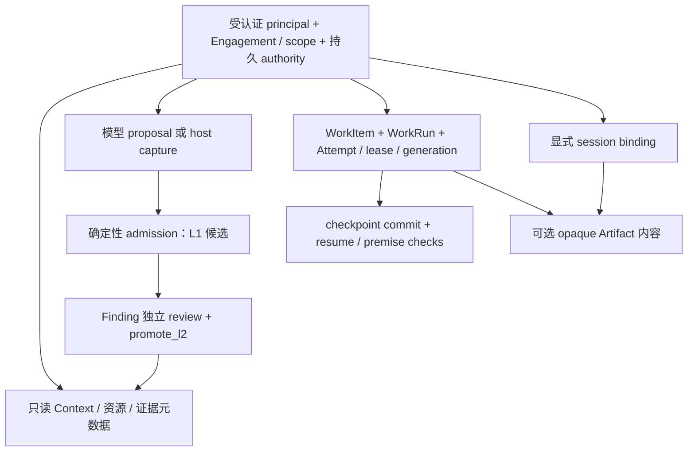

# 先补齐可验证的接入闭环，再按测量结果扩展 Taric 能力

- 更新日期：2026-10-25
- 状态：实施完成并已归档；正文保留 2026-10-17 的设计基线与建议语气，当前合同以接入/API/运维文档为准，具体完成情况见下表。
- 评审基线：本文保留 `c3db857e937c04293eb08e258ca98c8e24a2b897` 的历史设计讨论；当前实现和测试以候选 release report 为准。
- 讨论入口：以本文的建议编号开展评审；来源为 [BreachWeave 推演](taric-gap-analysis-breachweave-integration.md)与 [CyberStrike 推演](taric-gap-analysis-cyberstrike-integration.md)。

## 实施状态（2026-10-25）

[既有任务](../openspec/changes/archive/2026-10-25-close-host-sync-contract-gaps/tasks.md)已完成；[当前验收记录](../openspec/changes/harden-taric-authority-runtime/release-report.md)给出最新实现与测试索引。以下结果取自候选证据，本次文档更新未重新采样性能或重新认证第三方宿主。

| 决策 | 当前交付与证据 |
|---|---|
| I-01 采用闭环 | [接入指南](agent-integration.md)与[中文集成方案](Taric面向渗透测试智能体的集成方案.md)提供 A～E 依赖闭环、真实宿主职责、成本记录与适用条件；无人工成本/ROI 结论。 |
| I-02 Node 代理 | `taric proxy` 与真实 Bun client 已实现；[proxy v5](benchmarks/proxy-restart-v5.json)覆盖 26 次调用、两次重启、0600 socket、幂等/CAS/迟到隔离。范围限所测本机拓扑。 |
| I-03 强制归属 | 持久 `host-session`/`run-bound` 模式与 transport session 校验已实现；Artifact 上传与发布恢复复验 fence，省略字段不能降级；host-session 不承诺 lease 保证。 |
| I-04 能力状态 | 自定义 adapter ID 已开放；package/distribution/version/commit 分列，实例能力合成实现、运行绑定、授权、认证证据与质量状态，未知 native 版本不获认证。 |
| I-05 有界读取 | 固定 read_seq/read_time 的 keyset、v2 加密 cursor 与有界 resume 已实现；[50k 测量](benchmarks/authority-scale-v3.json)首屏 3.08s 对比 5.36s 降低 42.5%，未达到 50% 候选目标，无通用 2s SLA。 |
| I-06 原文与维护 | CLI 文件流/独立 binary socket 支持 64 MiB decoded chunk，普通 RPC 仍 1 MiB；[原文实测](benchmarks/artifact-transport-v2.json)、[维护实测](benchmarks/maintenance-concurrency-v2.json)与崩溃故障测试已交付。无显式 fsync/断电保证。 |
| I-07 宿主状态 | `host.state` 有界聚合与退避轮询已实现；Core in-process 与 authenticated adapter RPC 提供 best-effort bounded subscription，并以 query/read_seq 恢复；[轮询测量](benchmarks/host-state-poll-v1.json)满足该 fixture 的 1000ms 预算，MCP resources subscription 仍 disabled。 |
| I-08 导入边界 | 公开 `snapshot.import` 在 dispatch/Core/CLI 明确拒绝，内部隔离 restore 不构成宿主迁移 API；旧材料通过正常 proposal/evidence 治理接入。 |

[历史干净构建报告](benchmarks/capability-verification-v2.json)记录了旧基线 339 项测试，不能作为当前树的构建证据。[当前候选 release report](../openspec/changes/harden-taric-authority-runtime/release-report.json)记录 350/350 Core、clean consumer、proxy restart/replay、profile manifest 与 OrbStack PostgreSQL runtime 门禁；工作树为 dirty，质量证据因人工标注/基线样本为 0 而 blocked。Bun driver 已在当前候选中验证，远程传输、MCP Tasks、MCP resources subscription 和第三方宿主仍按 profile 单独判定。

## Abstract / 摘要

两份推演有价值，但不足以直接作为实施清单。它们共同揭示了接入说明、能力依赖、宿主工程责任和能力声明的一致性问题；其中部分判断混淆了“不能进程内嵌入”与“不能集成”、“状态差分”与“可靠事件流”、“功能名称重叠”与“保证等价”。我们建议先交付可运行的最小治理闭环、明确的会话与运行归属、可信的能力状态，再优化已有测量暴露的大读与 Artifact 成本。宿主通知作为后续可选优化，Bun 原生驱动、远程传输与 MCP Tasks 不进入首批必交付项。

**接入可以减少采用的能力数量，不能减少已采用能力的身份、隔离、信任和错误约束。** Core 继续拥有唯一治理逻辑；单机默认持久 SQLite，多主机显式选择并通过证据门控，任何失败都不能静默回退。

## Background / 背景与动机

### 1. 评审以 Taric 的边界和源码为准

本次核实了 Taric 的源码、操作注册表、规格、现有测试内容、保存的基准和发布报告。没有执行 BreachWeave/CyberStrike，也没有复现两份报告的宿主侧全量走读。因此，宿主架构描述作为需求样本使用，不升级为已验证的集成结果；已有 benchmark 数字是历史测量，不是本次新跑的性能结果。两份报告没有统一固定宿主提交、运行环境和端到端证据，不能据此宣布真实宿主认证通过。

方案严格保持以下范围：

| 必须提升的目标 | 不进入本次方案的方向 |
|---|---|
| 各 transport 的身份分配、proposal 校验、L1/L2 转换和错误结果明确一致 | PostgreSQL 复制一套治理逻辑；模型直写或绕过独立审核 |
| CLI/MCP 共享启动决策；单机持久化默认；多主机 fail closed | 为了接入方便自动切换数据库、建立伪共享 SQLite |
| SQLite 单写者下，大读、cursor、Artifact 恢复和维护成本可测且有界 | 通用事件重放、搜索索引、任意 Artifact 路径访问 |
| 实现、运行时启用、证据和发布结论分别报告 | 新增受支持的 snapshot import 或历史状态导入产品能力 |
| 保留 64 MiB decoded chunk 合同，凭测量决定耐久性取舍 | 未经基准降低 chunk 合同、无条件增加 fsync |
| operator 维护显式执行并测量影响 | 未测 event-loop 影响就迁移到异步 worker |

### 2. 已经完成的硬化不能重新包装成新增能力

[既有硬化实现](../openspec/changes/harden-taric-authority-runtime/)已经记录 writer 分配 UUIDv7、提交前校验、显式 L2 promotion、持久 cursor key、统一启动入口与共享 Core 后端验收。当前 [runtime-service.ts](../packages/core/src/runtime-service.ts)也确实在 CLI/MCP 共同的启动路径上消费编译实现、schema、policy 摘要绑定的 PostgreSQL 证据。

后续改进应对这些合同做接入与回归验证，而不是再设计一套 resolver、身份生成器或 PostgreSQL 治理服务。保存的发布报告区分“实现完成”和“质量发布证据待补齐”，这一纪律应继续保留。当前机器是否仍有健康 PostgreSQL、旧报告能否匹配当前构建，必须由当前只读 readiness 决定，不能引用旧报告中的部署状态代替检查。

### 3. 提案时的代码基线支持几项差距，但也推翻了部分推论

| 核实结论 | 当前证据 | 对设计的影响 |
|---|---|---|
| Node SQLite 是实际的加载依赖 | [sql-driver.ts](../packages/core/src/sql-driver.ts)静态导入 `node:sqlite`，同时定义 SQLite/PG driver；[index.ts](../packages/core/src/index.ts)导出依赖 store 的入口 | 导出接口本身不能消除 Bun 的运行时导入障碍；但 Node 独立进程仍可接入 |
| 自定义 native adapter 的描述类型封闭，通用 Core service 并不封闭 | [adapter.ts](../packages/core/src/adapter.ts)的 `AdapterHostId` 是三项联合；[service.ts](../packages/core/src/service.ts)的 principal 并未限定这三个框架 | 是 adapter 可扩展性差距，不是所有自研宿主无法接入 |
| Pi 状态存在多层漂移 | [pi-adapter.ts](../packages/core/src/pi-adapter.ts)只静态列出两项能力；[adapter.ts](../packages/core/src/adapter.ts)注册后按工具与 binding 计算更多能力；[compatibility.ts](../packages/core/src/compatibility.ts)声明相关 hooks supported；[README](../README.MD)仍写 unsupported | 不能简单把 manifest 文案覆盖到所有位置；需要区分已实现、已绑定、已认证 |
| MCP 当前只有六个模型工具，尚无资源订阅 | [server.ts](../packages/mcp/src/server.ts)只声明 `tools`，协商返回 `2024-11-05` | 推送确实缺失，但新增 resources 还涉及协议版本、路由、授权、背压和客户端行为 |
| `resume delta` 是有成本的状态差分 | [context.ts](../packages/core/src/context.ts)的 `resumeContextDelta`获取前后两个 snapshot，并读取、过滤 `store.events()` | 不是现成的有界 changefeed；事件 hash 的子集也不能证明完整投递 |
| host 捕获仍是 proposal 入口 | [service.ts](../packages/core/src/service.ts)的 `captureObservation`委托 `submitProposal` | “宿主捕获成功”不等于 canonical 已准入，更不等于 L2 |
| 不提供 run 字段时，Artifact fence 不检查运行租约 | [artifact-content-store.ts](../packages/core/src/artifact-content-store.ts)的 `assertFence`三项全缺即返回；session bind 目前不记录必需的 run 模式 | 不能仅因参数可选就宣布“单写者无 fence 模式安全成立” |
| L1 可以显式查询 | [registry.ts](../packages/schemas/src/registry.ts)已有 `proposal.list`，Core 查询有 candidates 选项 | 缺少的是汇总与巡检路径，不能说 L1 “完全不可见” |
| 64 MiB Artifact 与现有 RPC 帧上限不匹配 | [adapter-rpc.ts](../packages/core/src/adapter-rpc.ts)每行限 1 MiB；[Artifact 基准](benchmarks/artifact-profile-v1.json)单 chunk base64 为 89,478,488 字符 | generic RPC 可转发元数据，不代表已经支持完整 Artifact 上传合同 |
| snapshot import 已出现在当前 operator 操作中 | [registry.ts](../packages/schemas/src/registry.ts)与 [service.ts](../packages/core/src/service.ts)均包含该操作 | 与本次“不扩展为受支持导入能力”的边界需显式处理，不能借此推广历史导入 |

### 4. 已有性能证据足以改变建议的优先级

[Authority 基准](benchmarks/authority-scale-v1.json)在 Node v22.21.1、macOS、指定 fixture 下记录了以下结果；commit/admission 各有 100 个样本，Context continuation 只有三个测量页：

| 指标 | 10k fixture | 50k fixture | 能证明什么 |
|---|---:|---:|---|
| commit p95 | 9.3 ms | 20.2 ms | 指定写路径的本机延迟 |
| proposal→L1 p95 | 139.4 ms | 66.2 ms | 不含 L2 等待，也不是所有交互路径 |
| Context 首屏 | 1.23 s | 8.38 s | 首屏已存在大读成本 |
| Context 续页 | 约 0.9–1.0 s | 约 3.8–4.4 s | 续页仍重取和排序 pinned snapshot |
| snapshot / export | 0.43 / 1.23 s | 2.02 / 4.98 s | O(N) 物化操作需单列预算 |

[Artifact 基准](benchmarks/artifact-profile-v1.json)的 64 MiB × 2 文本/二进制交错上传记录约 801/922 MiB 峰值 RSS、28.6/27.9 秒的两样本 p95。这里的“并发”是交错上传、同步阶段串行；两样本分位数只能作初步观测，不能成为容量或尾延迟保证。

因此，“所有同步路径需要亚秒级”“发布 p95≤2s 就满足交互需求”都不能成立。相比未经测量的 Bun 移植或全面订阅，Context 重复全量读取和 Artifact 复制峰值有更直接的优化依据。

## Design / 设计

### 5. 对两份报告逐项裁决，保留问题而修正解法

下表中的 P0/P1/P2 是本方案的交付顺序，不沿用原报告的营销或采用优先级。

| 来源与建议 | 判断 | 收敛后的处理 |
|---|---|---|
| BreachWeave RM-1：公开 driver、增加 exports、提供 Bun driver | 部分采纳 | P1 先提供 Node 宿主代理；driver 移植列为有需求证据的后续项。exports 只暴露稳定入口，不把完整存储内部接口直接产品化 |
| RM-1：发布 conformance 套件 | 采纳但补齐条件 | 复用现有共享 Core 场景及真实隔离 fixture；driver 层还需事务、savepoint、时钟、初始化和重启测试，不能把 12 个后端场景等同于驱动认证 |
| BreachWeave RM-2：开放宿主契约、泛化事件 | 采纳 | P1 允许标识自研 adapter，保留服务端认证与能力证据；避免把 Pi 类型名称当通用规范 |
| RM-2：未知 patch 默认兼容、支持两个 Pi 分发 | 不直接采纳 | 未测试版本不自动 supported；每个 package/fork/version/commit 单独取证。兼容区间必须有区间边界测试支持 |
| BreachWeave RM-3：宿主通知、合并、重鉴权 | 有条件采纳 | P2 先完成有界状态读取与轮询基线，再用实际轮询成本、发现延迟决定是否启用订阅 |
| RM-3：WorkRun 映射 Tasks、HITL 映射 input_required | 暂缓 | 两类任务的生命周期、取消和授权语义不等价，当前模型工具也不需要据此新增长操作 |
| BreachWeave RM-4：最小接入闭环与能力图 | 重点采纳 | P0 明确角色、依赖和召回结果；P1 用真实接口跑通，不能把 5–6 个 operation 当完整初始化清单 |
| BreachWeave RM-5：host-native bootstrap / 历史导入 | 不采纳产品能力 | 不新增 import API、snapshot import 支持或通用迁移器；可记录宿主如何用正常治理入口逐条提交候选，历史内容不能冒充当前观察 |
| BreachWeave RM-6：TCP/HTTP | 暂缓工程扩展 | 先把同机/容器宿主代理写清；网络监听需要独立威胁模型和 transport 合同，不能直接复用本地 token 就宣布完成 |
| BreachWeave RM-7：能力分区与文档一致性 | 重点采纳 | P0 记录分区、校验状态；没有包依赖和独立采用证据前不拆治理/覆盖/Artifact 包 |
| CyberStrike RM-1：增量价值、不适用场景、成本披露 | 重点采纳 | P0 用保证与责任对照；成本采用实测工时与运行开销，不制造 ROI 或人周精确值 |
| RM-1：三处能力独立销售/使用 | 部分采纳 | 跨会话、恢复、证据链可分别展示，但必须列依赖闭包；checkpoint 仍依赖 WorkRun/Attempt，数据写入仍走治理 |
| CyberStrike RM-2：分层、Artifact/WorkRun 矩阵 | 重点采纳 | P0 区分读、候选、验证、恢复、内容五种接入闭环；不定义“零治理 canonical 写入档” |
| RM-2：单写者无租约模式 | 部分采纳并加固 | 允许明确的 host-session 捕获，不宣称运行 fencing；run-bound 会话不得通过省略字段降级 |
| CyberStrike RM-3：宿主代理参考实现 | 重点采纳 | P1 复用 Core 与现有 RPC/CLI，提供可运行参考；不新造 agent runtime 或第二套权威层 |
| CyberStrike RM-4：同步路径预算与批量/异步用法 | 采纳测量，收窄实现 | P1 分离排队、执行、审核等待、传输；没有批量语义与测量前不新增 batch API，也不异步化 operator 维护 |
| CyberStrike RM-5：整合阅读路径、证据索引 | 采纳 | P0 对齐来源、结论、实现状态和验收项；宿主推演与真实认证分开 |

两份报告中“核心机制已全部做对”“没有核心实质缺陷”的结论都过强：集成推演只能支持所检查路径的判断，无法覆盖所有 transport、运行归属和失败窗口。BreachWeave 的“运行时移植是唯一无法绕过的硬阻断”也不成立，报告自己已经列出 Node sidecar。MCP tools 可以执行只读查询，查询放在 tools 并不违背规范；resources 是额外的数据交互机制。[MCP Tools 规范](https://modelcontextprotocol.io/specification/2025-11-25/server/tools)

以下数字不用于决策：CyberStrike 的“60% 重叠”“70% 等效保护”、BreachWeave 的“500–1000 行即可覆盖大部分”“5% 集成成本”。报告没有给出统一功能权重、误报/漏报数据、工作量记录或等价验收。机制相似不证明保证等价，不能据此削弱独立审核，也不能断言哪个宿主“必需”Taric。

### 6. I-01：用依赖闭包说明最小采用方式

我们把采用梯度定义为不同闭环，而不是不同安全等级。只读接入可以消费已有权威状态；要让新内容进入普通召回，仍须满足该记录类型的准入和信任要求。



图中 WorkRun→Artifact 表示采用运行归属时的依赖；host-session 内容并不强制要求 WorkRun。外部 Artifact 引用也不要求启用本地 spool。

| 闭环 | 最少需要的能力与角色 | 明确不保证的事项 |
|---|---|---|
| A：读取已有长期记忆 | operator 初始化 Engagement/scope；认证 reader/model；`context.query`或资源/证据查询 | 不替宿主建立新事实；不跨 Engagement 自动共享 |
| B：积累受治理候选 | A 的基础；model `proposal.submit`或 host `capture.observation`；host/writer/operator `admission.evaluate`；显式候选查询 | L1 不默认成为普通事实召回；不承诺 Finding 已验证 |
| C：发布已验证 Finding | B；已钉住的 evidence/claim/scope；独立认证 reviewer `review.submit`；writer/operator `admission.promote_l2` | 不签发攻击授权；不证明观察本身绝对真实 |
| D：恢复具体工作运行 | A；WorkItem、host `work.claim/renew/reclaim`、有效 Attempt/generation；`checkpoint.commit`与 `work.resume` | checkpoint 不是任意会话摘要；不提供 agent 调度或目标资源锁 |
| E：保存/核验证据原文 | A；host/operator 显式 session bind；Artifact begin/append/commit；原文读取另需 `content_read` | 不解析、脱敏、搜索、自动保留或签发取证认证；关联证据仍走正常治理 |

最小文档必须同时展示成功结果和信任边界。例如：

```text
model: proposal.submit(expected_version=0, content 无 canonical id)
  → pending proposal；此时不能说“记忆已更新”
host/writer: admission.evaluate(proposal_id, policy_digest, expected_version)
  → L1 candidate；普通事实召回仍不把它当 verified Finding
reviewer: review.submit(身份与 attestation 来自认证 transport)
writer: admission.promote_l2(钉住 target/version/input/evidence/review/policy)
  → 通过完整硬门后才产生可按规则召回的 L2 Finding
```

该例只表示 Finding 治理主线；初始化、Resource、Observation、Evidence、Claim、scope 和 reviewer 绑定需要在可运行示例中完整建立。非 Finding 记录按各自合同处理，不能把 Finding 专用的 L2 promotion 当成所有类型的通用晋升接口。

成本说明采用两类宿主的工作分解：已有确定性 bridge 的宿主主要做字段映射、身份与状态回传；只有模型工具入口的宿主还需建立受认证的非模型服务入口、证据捕获与审核职责。记录每一项实际工时、失败调试次数、调用数、人工复核等待和运行开销。未做 POC 前不填人周估算。

不优先推荐采用的场景包括：短周期一次性会话、已有足够的确定性状态且不需要跨会话治理、团队不能维护独立审核链。需要跨主机共享但尚无匹配后端证据的部署也不能被当成现成支持场景。是否适用由所需保证与集成成本决定，不由宿主 agent 数量单独决定。

### 7. I-02：先交付 Node 宿主代理，再决定是否移植驱动

首条非 Node 接入路径使用 Node 进程运行现有 Core。Bun 宿主通过自身受信任 bridge 请求服务，容器内的 worker 使用宿主已有通道；宿主负责身份绑定和工具结果捕获。CLI 与模型 MCP 继续使用同一 `resolveRuntimeAuthority`/`openRuntimeService`，参考实现也复用这条启动路径。

```text
Bun 宿主 / 容器 worker
  → 宿主已有的受信任 bridge（模型只提交提案）
  → Node Taric service / 本地认证 RPC
  → 同一个 Core governance → authority

宿主审核流程 → 独立 reviewer transport → 同一个 Core
```

参考实现需包含：

1. 显式 Engagement 与 transport principal 映射；忽略模型传入的 role、host_id、trust 字段。模型文字不能仅因经 bridge 转发就变成 host observation。
2. 用实际工具执行结果建立 Observation/Evidence 元数据或外部 opaque Artifact 引用。受限 MCP 不获得 host/writer/operator 身份。
3. writer 与 reviewer 走各自认证入口。现有 `listenAdapterRpc`只接受 Engagement-scoped host principal，不能声称这一条 RPC 已支持独立 reviewer 或 operator；同进程受信任调用/隔离 CLI 的凭据也不能交给模型。
4. 完整表达 pending/L1/L2、CAS、幂等冲突、stale attempt 和结构化错误。收到 `ok:true`也要检查实际业务状态，例如被隔离的迟到 proposal 不是已接纳结果。
5. 明确同机、容器 socket 挂载、启动/关闭/重启和密钥责任。代理不重写治理、不调度 worker、不签发动作授权。

默认代理路径先使用外部 Artifact 引用或受信任 Node 进程内的内容 API，不声称 1 MiB JSONL RPC 已支持 64 MiB 上传。若要通过 RPC 上传完整 chunk，应对该操作单独采用已有 Artifact deployment profile 的 envelope 上限，采用有界读取与流控，拒绝超限且不得部分发布；不得粗暴取消所有 RPC 帧限制。此项必须经过真实 transport 的 64 MiB × 2 验证才算完成。

只有当实际宿主不能接受 Node 进程，且 POC 证明这是采用阻断时，再推进 Bun driver。届时应把 driver 类型、SQLite 实现与 PG 实现分离，并修正全部入口的静态依赖图，证明目标 Bun 入口不会加载 `node:sqlite`。只加 `exports`或 `export type`不能完成这一目标。

移植仍复用 AuthorityStore/Core 治理，不复制状态机。验收包括 driver 的事务/嵌套事务/排队/错误回滚与重启，以及现有十二个 Core 场景、真实 Artifact 故障和 cursor 测试。当前 `runAuthorityRuntimeConformance`允许传入 callback；callback 返回非空证据字符串并不自行证明实际运行过场景，发布工具必须负责固定真实场景、隔离 fixture 和产物来源。

### 8. I-03：把运行归属写成不可通过省略字段改变的合同

“单写者”只描述 SQLite 并发写入模型，不能证明没有迟到结果、进程重启或旧 worker。我们不增加一个全局“关闭 fencing”的模式。

| 写入归属 | 所需校验 | 对外保证 |
|---|---|---|
| host-session，无运行绑定 | host/operator、Engagement、显式 session、server-owned ID、schema/引用/版本/幂等 | 会话内的确定性捕获与内容完整性，不保证 WorkRun owner/lease fencing |
| run-bound session / worker 运行 | 上述检查，加 WorkRun、Attempt、generation、owner、当前 lease 和 session 关联 | 拒绝或按既有合同隔离过期/迟到运行结果 |
| 模型提案 | model principal 与受限 envelope；有运行绑定时沿用对应归属 | 始终仅有提案权，无直接 canonical 写入权 |

现有条件 fence 适合描述前两种用法，但当前 session binding 没有强制模式。需要在受信任 session/transport binding 中持久记录是否绑定 run；run-bound 写入缺字段、少字段、错 owner、旧 generation 或 lease 过期都不得降成 host-session。Artifact 的 binding 约束同时覆盖 begin/append/commit/recovery publication，proposal/capture/checkpoint/action 的运行归属也做一致性核查。

绑定只由 host/operator 管理；模型请求不能改变模式。同一 session 不允许请求级降级，切换工作归属应建立新的显式绑定。服务端只能验证已注册的身份与归属，不能凭内容推断某条未绑定 host 请求实际来自哪个 worker；宿主仍需如实捕获并路由。没有这条约束和测试前，文档应明确当前条件 fencing 的范围，不能宣布已经防住“全部省略字段”的路径。

错误结果继续使用现有注册表，逐项明确：非法 envelope 返回 `validation_error`且无状态改变；权限错误返回 `authorization_error`；旧版本/运行失效按既有 typed code 或显式 quarantine 结果处理。不能为了“一致”把已有的迟到隔离、schema 拒绝和幂等冲突全部映射成同一错误。

### 9. I-04：能力清单必须反映当前实例与当前证据

我们保留“单一事实源”的方向，但不把一个静态常量当成全部事实。最终可用能力是实现支持、认证版本范围、当前 binding、principal 权限、后端 readiness 与匹配证据的共同结果。

| 维度 | 回答的问题 | 不得作出的推论 |
|---|---|---|
| implementation | 代码路径是否存在 | 存在即启用 |
| certification/evidence | 哪个 package/version/commit、场景、构建摘要经过什么验证 | mock 测试即真实宿主端到端认证 |
| runtime | 当前 profile、服务、binding、依赖是否满足 | 历史健康报告即当前可用 |
| authorization | 当前 principal 能否调用 | 宿主自报 capability 即授予 host/writer 权限 |
| quality release | 是否有代表性独立标注、human baseline、分层统计证据 | 算法存在或 synthetic fixture 通过即质量达标 |

先修 Pi：保留真实 package/version/commit；descriptor 表示已认证的静态上限，注册结果只返回实际绑定且满足运行条件的能力。例如只有 checkpoint callback 而没有有效 run binding，不能声称 checkpoint 可用。README、`adapter.status`、`capability.status`与文档从同一合成结果生成或检查。未知版本可以走稳定的通用 CLI/Core 协议接入，但 native hook 不能自动标为 supported。

自定义 adapter 标识可开放为经过格式校验的标识，框架 package/distribution 单独记录。功能协商只决定可以使用哪些集成功能，不能决定 principal 的权限。首批不自动认证第二个 Pi 分发，也不引入没有测试依据的 semver 宽区间。

后端继续使用分阶段合同：存储原语可用 → 同一 Core 场景通过 → 当前部署只读 health/schema/lease 检查通过且证据摘要匹配 → 显式 profile 激活。PostgreSQL 已有实现和保存的 live 证据，不应被重新描述为“只有原语”；默认 single-host 仍然不启用它。失去 schema/fencing/服务健康时按现有合同阻断，禁止 SQLite fallback，禁止生产启动时运行会写入 fixture 的 conformance。

质量发布证据单列。代表性数据缺失使对应质量声明 blocked，不抹去已经验证的技术能力，也不把全部功能伪装成已通过质量发布。

### 10. I-05：先消除续页重复全量工作，再增加新的读取表面

我们沿用 SQLite WAL 单写者和当前异步 Core facade；Promise 接口不代表底层同步 SQLite 工作已经移出 event loop。

第一步补齐读取成本明细：SQL 次数与返回行数、snapshot hydration、排序、白名单投影、序列化、cursor 字节、排队时间、event-loop delay、峰值 RSS。Context 首屏、续页、resume、普通列表和维护单列，保留 10k/50k fixture，增加大历史/高 churn 和多 Engagement 干扰样本。

第二步复用已有 `recordsPage`的 pinned/keyset 思路，把 Context 的必含项与其余排序组分开读取，过滤下推，按稳定排序键和 ID 获取有界候选；resume 的事件读取按 Engagement、序列范围和页大小查询，按变更 subject 钉住版本，避免每次 `events()`全表返回。权威库上的访问索引属于实现细节，不新增搜索索引或通用事件查询/重放产品。

这不是简单把 `snapshot()`替换为一个 `LIMIT`。实施时必须保存当前排序与信任过滤、freshness 的固定 `read_time`、scope/blocked/未测覆盖的强制可见、`omitted_ranges`及补全语义。预算不足要返回明确错误或 continuation，不能静默跳过安全必含项。扫描工作设置独立上限，无法在预算内完成时明确返回可续读状态，不把部分结果声称为完整。

cursor 继续绑定 authority、principal、Engagement、`read_seq/read_time`、policy、filters、ordering、budget 和过期时间，并使用持久密钥。新 cursor 用排序位置重建续页；确认排序单调和无重复/遗漏后，才可减少当前会随页数增长的 delivered-ID 状态。不把全量记录塞入 cursor，也不增加服务端永久快照缓存来回避成本。格式可直接升级，旧 cursor 明确 `invalid_cursor`。

候选性能目标需要与基线同机复测后确认：50k Context 首屏相对基线至少降低 50%，续页不再重复 hydrate 全量记录；同时报告 p50/p95、样本数与内存，不提前承诺所有读取小于 2 秒。对 continuation 的验收首先看读取行数和 cursor 大小是否随页大小而非整个数据集增长，再看延迟。

### 11. I-06：Artifact 与维护按真实 transport 测量，保持耐久性边界

Artifact 首批工作包括两件事：对齐各受支持入口的 decoded/envelope 限制；定位 base64 字符串、解码 Buffer、staging copy、hash、JSON 序列化的同时存活量，减少冗余拷贝并实测。保留 64 MiB decoded chunk 的服务能力，不要求模型 MCP 承载原文。

基准至少覆盖 1/2 个并发上传、文本/二进制、真实进程间 transport、超限拒绝、慢客户端和重启故障；尾延迟使用足够样本并报告样本数。报告等待时间、吞吐、RSS、event-loop delay、失败数、watermark 和 publication 状态，不能只给内部方法耗时。

耐久性继续声明 `local_process_crash`，默认无显式 fsync；rename、publication marker 和 catalog 恢复通过不等于断电持久。只有对照无 fsync 与候选同步策略的延迟、吞吐、故障结果及文件系统环境后，才考虑新增显式部署 profile。保持“未核验内容不能 available”，不新增任意路径读取、不解析或脱敏 payload。

维护仍限 operator，doctor/verify/reconcile/export 的只读或修复模式明确分开，记录固定序列、水位和运行时长。先测维护期间普通写入排队、lease heartbeat 延迟、event-loop delay 和 WAL 增长；必要时推荐现有独立 CLI 进程及维护窗口。只有数据证明进程隔离仍不足，且单独连接的事务/锁/取消设计就绪后，另立变更评估 worker，不能用 `setImmediate`或包装 Promise 宣称已异步化。

### 12. I-07：通知只减少发现延迟，不能成为正确性依赖

报告提出的“无内容信号到宿主，再按授权读取”方向正确。应先提供有界 host 状态视图，汇总可访问 Engagement 的 L1 待审数、Conflict/Impact、unknown action、租约异常与对应水位。已有查询继续可用，不要求宿主为了知道有变化而频繁构建完整 delta。SLA 和 freshness 到期需要固定读取时间与显式计算，不能假设只有 commit 才会改变状态。

宿主先定期轮询、失败退避，记录查询开销和变更发现延迟；planner 是否唤醒、何时安排 review、是否执行动作仍由宿主决定。只有轮询成本或延迟违反宿主已记录的预算时，再交付可选订阅。

采用 MCP 时复用标准 `resources/subscribe`与 `notifications/resources/updated`；标准通知参数是 URI，不把自定义 `read_seq`塞进标准消息。读取结果再返回受授权的版本或水位。URI 使用稳定的资源标识，不把变化的 `since`游标编码为订阅身份。[MCP Resources 规范](https://modelcontextprotocol.io/specification/2025-11-25/server/resources)

实施订阅必须同时满足：

1. 作为独立启用的 host 接入面，完成协议版本协商和 resources list/read/subscribe/unsubscribe。当前六工具模型 MCP 不因增加 resources 自动获得 host 待审队列或 Artifact 原文能力。
2. 每个会话只订阅获准的 Engagement/资源类型；读取与投递时重新鉴权。降权、解绑或 scope 改变后取消相应订阅，不暴露其他 Engagement 的变化、全局序号或存在性。
3. 每 principal 的订阅数、资源数、消息频率、待发字节与 socket 队列均有限制；慢消费者合并同一 URI 的脏标记，仍无法发送则断开，由轮询恢复。不保存逐事件持久投递队列。
4. 订阅注册前后核对状态水位，关闭“先读后订阅”的丢变更窗口；重连先重新读取。跨进程提交用有界水位检查或现有可信提交来源检测，不能仅监听当前进程 callback，也不抢占现有 outbox 消费者。
5. 通知采用尽力投递和合并语义，不承诺至少一次或逐事件有序；漏通知不影响正确性。宿主只有读完某个 pinned 范围并完成本地应用，才推进最后完成水位。旧位点无法继续时显式失效并重新查询，不推广为通用事件重放。
6. 通知不触发模型调用、任务调度或自动维护；投递数量、合并、断开、延迟使用运维指标，不把每次通知写入不可变 authority 审计链制造写放大。

Tasks 暂缓。2025-11-25 规范明确将其列为 experimental；“SEP Final”不等于运行机制稳定或客户端均支持。WorkRun 是领域状态，MCP Task 是请求执行状态，不能机械映射取消、lost、reclaim 或 HITL 审批，更不能让 task cancel 代表目标动作已停止。[MCP Tasks 规范](https://modelcontextprotocol.io/specification/2025-11-25/basic/utilities/tasks)

Triggers & Events 工作组章程也不是已交付协议；本方案不实现 webhook，也不依赖其未来语义。[工作组章程](https://modelcontextprotocol.io/community/working-groups/triggers-events)

### 13. I-08：存量接入沿用正常治理，不新增导入产品

初次采用允许从当前 scope、资源与新观察开始。宿主如需引用旧材料，可以用现有 proposal/外部证据引用表达，明确原始时间、来源与 limitations，接受正常 schema/引用/信任校验，不承诺批量迁移或自动提升。

不能直接照抄报告中的 `source_kind: import`食谱：虽然 schema 有该枚举，当前 service 会把 proposal provenance 的来源绑定为 model/host。若要保留历史材料来源，应先明确可信 transport provenance 与材料 provenance 的区别；本次不为了导入新增特殊信任路径，也不允许内容自报覆盖 transport 身份。

当前 registry 的 `snapshot.import`需要与本次支持边界对齐：后续实施将其移出对外受支持操作清单，或明确返回 `unsupported_capability`，同步 CLI/文档/测试。隔离 conformance 和灾备验证可保留内部逻辑恢复工具，但不把它公开包装为宿主状态导入、完整审计恢复或一般事件重放。现有 canonical ID/版本保留的恢复场景，不得借机开放为普通创建接口。

## Rationale / 理由与取舍

### 14. 我们优先补证据与端到端路径，接受有限的功能扩展

| 决策 | 未选择的方案 | 取舍理由 |
|---|---|---|
| 先 Node proxy，Bun driver 以 POC 需求触发 | 首先承诺多 runtime 全量支持 | 复用现有运行时与治理，先验证接入价值；代价是宿主多维护一个 Node 进程 |
| 通用协议可接入，native hooks 按证据认证 | 未知版本自动获得最小 native 能力 | 不把 semver 相似当事件语义等价；代价是认证范围扩展较慢 |
| 缩小采用闭环，保持信任规则 | “零治理”权威写入快车道 | 普通共享数据库不能提供 Taric 的事实分级与可追责边界 |
| 明确 host-session/run-bound | 以 SQLite 单写者为由允许忽略运行归属 | 单写者挡不住迟到结果；代价是需增加可信绑定与失败路径测试 |
| 有界状态读取先于通知 | 直接把完整 resume delta 挂到 resources | 先控制大读成本，避免每次通知又触发两次全量 snapshot |
| 尽力通知 + 权威重读 | “至少一次可靠通知”或持久消息队列 | 减少正确性依赖和队列责任；代价是宿主仍需重连与定期检查 |
| 同一 Core、分阶段后端激活 | PostgreSQL 专用治理实现 | 避免身份、硬门、事务与错误语义长期分叉 |
| 测量后再决定 fsync/worker | 立即 fsync 或异步化一切 | 保持已有 chunk、恢复与单写者合同；代价是暂不承诺断电耐久或无阻塞 |

审计哈希链和字节 hash 能揭示所覆盖的完整性问题，不能独立证明捕获来源真实、检测结论正确或“取证级合规”。Context/coverage 也不能证明资产发现完备。任务租约约束的是任务运行，不是多个任务对同一目标的互斥、限速或动作授权。这些边界要进入采用说明，不能把两份报告中“高必要性”场景直接变成产品保证。

## Compatibility / 兼容性

### 15. 本方案允许破坏旧格式，但必须显式失败

本项目不保留向后兼容承诺。后续可升级 adapter descriptor、绑定元数据、cursor 格式与 capability 报告，并移除对外 snapshot import 支持。旧 cursor 返回 `invalid_cursor`；未知 API/schema/adapter 版本和缺少可信绑定的运行写入返回明确错误，不猜测、不静默兼容。

代价包括宿主更新 binding 与状态消费逻辑、重新认证 adapter、重新构建与补采匹配证据。格式变更后旧基准/旧 PostgreSQL activation report 不自动继续有效；需要重新取证，而不是手工更改 evidence_state。涉及旧 authority 格式时，operator 使用显式备份和新环境验证，不为本次扩展增加 snapshot import 迁移入口。

CLI/MCP 的持久单机默认、单一启动决策、六个模型工具的权限边界、64 MiB decoded chunk、Artifact opaque 内容和 fail-closed 多主机选择，是后续迭代的回归验收约束。

## Implementation / 实现与验证顺序

### 16. 每阶段交付可独立运行的结果

| 阶段 | 交付内容 | 完成门槛 |
|---|---|---|
| P0：纠正承诺与依赖 | I-01 能力闭环/成本/适用范围；I-03 当前 fencing 边界文档；I-04 状态矛盾清单与规则；I-08 非目标清理方案 | 每条公开能力关联 operation、role、依赖、证据与限制；不再使用未经验证百分比或整体安全结论 |
| P1a：跑通最小接入 | I-02 Node proxy；I-03 可信归属约束；I-04 实例能力合成；同步 I-08 支持清单 | 一个 Bun 宿主进程经真实 transport 跑通候选→审核→L2→重启读取；模型与 host/reviewer/writer 边界拒绝测试通过 |
| P1b：优化已测瓶颈 | I-05 有界读取/续页；I-06 transport chunk 与内存/维护测量 | 固定快照无重复/遗漏，50k 对照测量与 Artifact 故障矩阵通过；未测性能不报告保证 |
| P2：由测量触发订阅 | I-07 host 状态视图与轮询；达到触发条件后实现可选订阅 | 有轮询开销/发现延迟数据；授权、慢消费、重连和跨进程变化测试通过，关闭订阅仍正确 |
| 后续：按真实需求立项 | Bun driver、网络 transport、特定 Pi 分发认证 | 各自具备独立需求、设计和完整证据；不作为前述阶段的隐含依赖 |

P1a 与 P1b 分别保留可工作的产品切片；不要求先完成未来全部可移植性或订阅设计才能采用现有治理。以上为提案时的交付顺序；截至 2026-10-18 实施与验收已完成，结果与未满足的质量/性能目标见本文顶部实施状态及归档验收记录。

### 17. 验收必须覆盖结果、失败副作用和资源边界

| 验收编号 | 场景 | 通过条件 |
|---|---|---|
| T01 | CLI/MCP 各自启动、写入后重启、切换 profile | 同配置解析到同一持久 authority；显式 memory 仅按请求；无匹配 PG 证据/健康时 blocked，不创建 SQLite fallback |
| T02 | 错误 kind、privileged ID、跨 Engagement 引用、错 schema 与额外字段 | 各 transport 保留稳定错误；proposal/canonical/audit/outbox/幂等状态无非预期改变 |
| T03 | host capture、L1 admission、review 与 L2 promotion | capture 仍为 proposal；L1 不被声称已验证；旧 review/input/evidence/version 不晋升；审核身份不可伪造 |
| T04 | run-bound 会话全部省略/部分提供运行字段、旧 owner/generation、迟到重试 | 不降级为 host-session；Artifact 不发布，proposal 按既有隔离合同可观测；显式 host-session 正常工作且不宣称 lease 保证 |
| T05 | Pi 缺 callback/run/tool binding、未知版本、自定义 adapter 自报权限 | 状态只报告真正绑定的能力；无证据 native 不 supported；capability 声明不提升权限 |
| T06 | 非 Node 宿主真实进程接入与进程重启 | 只依赖公开入口；捕获、提案、审核、读取语义一致；同机临时 authority 可重启恢复；不把跨进程测试当真实第三方产品认证 |
| T07 | 10k/50k、长历史、高 churn、分页中并发更新 | 每次读取绑定同一固定快照；排序与必含项不变；无重复/遗漏；报告扫描行数、cursor 大小、耗时和内存 |
| T08 | cursor 篡改、换 principal/Engagement/filter/budget、过期、密钥轮换与重启 | 对应绑定严格拒绝；合法续页跨重启可验证；不泄漏内部路径或原文 |
| T09 | 64 MiB × 2 经每个声明支持内容上传的 transport，及超限/慢消费 | envelope 与 decoded 语义一致；有界接收/队列；超限无发布；报告真实端到端时间与 RSS，内容 hash 相同 |
| T10 | manifest/rename/catalog 各故障点、进程中止、重复提交与重启 reconcile | 未验证内容不 available；publication/幂等结果可解释；恢复后仍校验绑定，不宣称断电耐久 |
| T11 | doctor/verify/reconcile/export 与普通写入、heartbeat 同时发生 | operator-only；固定水位；记录排队/event-loop/WAL；无静默历史改写或未经设计的后台 worker |
| T12 | 缺失/旧版/摘要不匹配/场景跳过的能力与后端证据 | implementation、runtime、evidence、quality 分列；不能据原语/算法或 skipped live tests 启用能力 |
| T13 | 订阅撤权、Engagement 切换、丢通知、乱序合并、重连与慢客户端 | 无越权信号；资源上限生效；重读后状态正确；不依赖逐事件投递，不自动调用模型或动作 |
| T14 | 外部旧材料与 snapshot import 请求 | 旧材料不冒充当前可信观察、不自报身份或 L2；对外不新增导入支持；一般事件重放与任意内容路径被拒绝 |

文档阶段做路径、事实引用和范围检查；实施阶段优先扩展现有 [API boundary](../packages/core/test/api-boundary.test.mjs)、[host adapter](../packages/core/test/host-adapters.test.mjs)、[运行时启动](../packages/core/test/runtime-startup.test.mjs)、[persistent cursor](../packages/core/test/persistent-cursor.test.mjs)、[Artifact](../packages/core/test/artifact-content.test.mjs)与 [runtime conformance](../packages/core/test/runtime-conformance.test.mjs)套件。依照具体改动执行 typecheck/build/相关测试；发布再跑独立干净构建和 live gate，不以本文引用的旧通过数量充当新版本结果。

### 18. 用最小证据包判断优化是否值得继续

每次阶段完成保存：源码/构建/schema/policy 摘要、运行时与宿主版本、fixture 和机器配置、命令、样本数、原始测量、错误/故障结果、能力状态与未验证范围。基准依照 [authority runbook](authority-storage-runbook.md)扩展；不得用 mock 返回的 evidence 文本取代真实测试产物。

采用 POC 的指标是：接通必需闭环的实际工时、宿主新增职责、每次候选与 L2 的调用/等待成本、跨会话恢复成功率、范围/前提变化能否被阻断、误用权限的拒绝率，以及大数据下的延迟与内存。POC 通过也只证明所测宿主/版本/拓扑成立。代表性误报/漏报、校准和人工基线另走质量发布门槛。

Bun driver 是否实施由 Node 代理的实际限制决定；订阅是否实施由轮询成本与发现预算决定；fsync profile 是否变化由耐久性/性能对照决定；维护是否迁移到 worker 由 event-loop 测量和独立连接设计决定。这四项均不能仅凭“底层原语已经存在”自动进入 enabled。

## Appendix / 证据与文档归属

### 19. 后续修改应回到已有文档，避免新增另一套事实源

| 内容 | 归属 |
|---|---|
| 采用闭环、角色、依赖与宿主责任 | [agent-integration.md](agent-integration.md)、[集成方案](Taric面向渗透测试智能体的集成方案.md) |
| transport 操作、错误、只读/写入与信任结果 | [taric-api.md](taric-api.md)、[operation registry](../packages/schemas/src/registry.ts) |
| 实例能力、认证范围和文档生成输入 | [compatibility.ts](../packages/core/src/compatibility.ts)与 adapter 实际 binding 结果 |
| Context/cursor 与恢复合同 | [context-recovery.md](context-recovery.md)、[context.ts](../packages/core/src/context.ts) |
| SQLite 大读、operator 维护与 benchmark | [authority-storage-runbook.md](authority-storage-runbook.md)、[benchmark-authority.mjs](../scripts/benchmark-authority.mjs) |
| Artifact transport、峰值、故障与耐久性 | [Taric API](taric-api.md)、[benchmark-artifacts.mjs](../scripts/benchmark-artifacts.mjs) |
| 多主机显式激活与证据匹配 | [postgres-runtime-readiness.md](postgres-runtime-readiness.md)、[runtime-service.ts](../packages/core/src/runtime-service.ts) |
| 技术完成和质量发布状态 | [硬化变更](../openspec/changes/harden-taric-authority-runtime/)及后续独立发布产物 |

两份推演保留为来源材料，后续评审引用本文 I-01～I-08 与 T01～T14 的裁决和验收范围，不再把原报告中未经验证的优先级、比例和必要性判断直接当作 Taric 的对外承诺。
