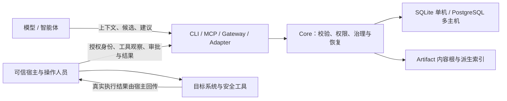

# Taric 架构与模块说明

## Taric 解决什么问题

攻防任务会产生大量观察、扫描结果、假设、证据和待办。普通对话历史难以保证内容有出处、不同智能体看到同一状态，也无法安全恢复中断的执行。Taric 为这些信息提供一个按 Engagement 隔离、可审计、带版本和权限控制的长期记忆与协作 authority。

Taric 保存并管理的是“宿主提交了什么、如何治理、当前允许什么状态迁移”。它不直接证明目标系统事实，不运行模型，不启动 agent，不执行目标请求，也不替宿主授权动作。模型产生的内容默认是候选；要变成更高信任状态，必须经过证据、Admission 和独立 Review 等治理环节。

## 系统边界



`Core` 是唯一业务权威。CLI、MCP、gateway、adapter 是不同使用者的接入层，共享同一组操作合同和 Core 授权规则。SQLite 保存单机 authority；PostgreSQL 用于明确配置并通过证据门控的共享 authority。Artifact 正文可以放在 Taric content root，也可以由宿主保存在外部，只向 Taric 提交引用。

## 五个主要模块

| 模块 | 解决的问题 | 典型使用者与接入方式 |
| --- | --- | --- |
| **CLI：`packages/cli`** | 给人、脚本和本机宿主稳定的 JSON 命令接口；提供配置发现、退出码、错误诊断、文件流式上传、本机 proxy 和远程 gateway 启动入口。 | 运维人员用它初始化任务、诊断状态、检查审计和修复派生状态；自动化脚本用 JSON 调用 operation；异构本机宿主使用 `taric proxy`。 |
| **Gateway：CLI 内的 `gateway` 子系统** | 将远程连接映射到固定身份，避免远程客户端直接持有 authority 数据库连接。它不是独立 package，也不是治理层。 | 多宿主集中部署通过 TLS TCP 或 HTTPS 访问；每个 token 固定映射 principal/role/Engagement。HTTPS 用于请求响应；TLS TCP 可用连接级会话和通知。 |
| **Core：`packages/core`** | 执行身份与 capability 检查、领域状态迁移、审计和持久化。管理记忆版本、证据、ScopeRevision、Coverage、运行 lease/generation、checkpoint、Action 结果及 Artifact 发布。 | Node 宿主进程内嵌 Core；CLI、MCP、adapter 和 gateway 经 CoreService 调用。Core 不执行目标系统动作。 |
| **MCP：`packages/mcp`** | 将 Core 允许的操作转成 MCP stdio named tools。工具名、输入 schema 和目录均由启动 principal 的权限动态生成。 | MCP 客户端或模型通过 `tools/list` 获取当前目录，再以 `tools/call` 使用上下文、提案和受控历史检索。一个进程只代表一个固定安全身份。 |
| **Schemas：`packages/schemas`** | 定义领域记录和每个 operation 的请求 Schema、版本、角色、能力与写入属性，是不同接入层共享的 API 合同。 | 宿主校验请求、生成类型、展示工具 schema 和运行合同测试。Schema 不代替 Core 授权，不能直接写数据库。 |

### 模块协作方式

1. 宿主从可信配置选择运行方式和 principal，并将请求送到 CLI、MCP、gateway、adapter 或进程内 Core。
2. 接入层按 `@taric/schemas` registry 验证公开请求格式；MCP 还据此生成工具目录。
3. Core 验证 principal、角色、capability、Engagement、版本、幂等键和业务前置条件，再在 authority 事务中提交状态及审计。
4. 查询返回受权限过滤、有界且可分页的数据。Artifact 原文走独立内容边界；索引或 Context 的水位用于判断结果是否完整。
5. 宿主根据返回状态自行决定是否调度、授权和执行外部动作，再把观察和结果写回 Core。

## 主要领域对象

- **Engagement**：任务和数据的隔离单元。一个 principal 只能在其绑定或获授权的 Engagement 内操作。
- **ScopeRevision**：不可变的目标范围和授权依据。可执行 WorkRun 必须绑定当前有效且已批准的 revision。
- **Resource / ResourceRevision**：目标资产及其不可变版本。引用和影响分析使用 canonical ID 与 revision。
- **Observation / Evidence / Claim / Finding**：从原始观察到论断和正式发现的证据链。Proposal 是候选提交；受信状态变化由 Core 策略控制。
- **Coverage**：预期测试维度及当前状态。Coverage gate 面向完整测试域，不能由搜索或上下文命中替代。
- **WorkItem / WorkRun / Attempt / Checkpoint**：由宿主创建、领取和恢复的工作状态。lease 与 generation 防止过期 worker 回写当前结果。
- **ActionIntent / ActionAudit**：模型建议、宿主授权决定和执行结果的分离记录。Taric 不发送目标请求或自动重放动作。
- **Artifact**：任务会话附件或文本。可以是外部引用，也可以是 content root 中的分块内容；原文默认不进入模型上下文。
- **ReportSnapshot / CloseDecision**：将报告与 Scope、Coverage、Evidence 和 Artifact 水位绑定，关闭状态通过版本控制并保留历史决策。

## 原文检索如何工作

宿主可把已提交的执行日志或文本输出作为 Artifact，并在开始存储时明确标记 `history_content_class: "execution_history"`。通过完整性检查后，Core 为该文本维护可重建索引。MCP model 必须另行获得 `history_read`，随后可查询事件、搜索片段并按偏移读取有限原文。

此能力的价值是让 agent 能基于之前的运行细节恢复推理，而不用把整份日志塞进 prompt。索引水位、完整性标志和固定 cursor 让宿主知道搜索范围；外部引用、二进制、未分类内容及 `task_credential` 不可通过此通道读取。宿主仍负责日志采集、脱敏、保留和 ACL。

## 场景一：攻防人员协作

1. operator 建立 Engagement、ScopeRevision、资源清单和测试计划。
2. agent 通过 MCP 或原生 adapter 获取 Context Pack，按预算读取必要背景。
3. agent 提交 Proposal；host 把真实扫描/工具输出整理成 Observation 和 Evidence，并更新 Coverage。
4. Admission 与独立 Review 根据规则处理候选，Core 记录决定和所引用的证据。
5. host claim WorkRun，执行自己批准的测试动作，保存 checkpoint，并回传结果；Scope 或 lease 无效时，Core 拒绝继续写入。
6. 报告和 Coverage 快照绑定到当前版本，operator 关闭 Engagement；中断时 host 查询工作状态并按 Taric 的恢复检查重新调度。

这样能让调查过程可追溯、多 agent 共享同一受治理的记忆，并减少恢复时重复执行或误把旧结果当成新结果的风险。Taric 不代替渗透测试人员判断证据是否足够，也不扩大 ROE。

## 场景二：智能体研发

已有模型运行时只需调用 MCP stdio，可先从默认 model profile 开始。宿主应在可信配置里创建身份、绑定 Engagement，然后让客户端根据 `tools/list` 动态适配工具；不要假设工具目录永久固定。需要让模型搜索先前的文本输出时，再为 model 单独开启 `history_read`。如需完整领域集成，可在 Node 进程内嵌 Core，或由 Pi/DeepSeek/Hermes adapter 将宿主回调映射为 Taric 操作。

模型负责理解和提出候选，宿主负责采集事实、调度 worker、审批和工具执行，Core 负责按合同检查并记录状态。这个分工让开发者能替换模型和宿主，而不需要让每个 agent 自己维护一份互不一致的权威记忆。

## 运行部署选择

- **单机**：SQLite WAL 是默认方案。多个本机进程可以访问同一 authority 文件；不能把文件放在共享盘作为多主机数据库。
- **多主机**：显式使用 PostgreSQL profile。所有宿主连接同一 authority，并通过当前构建 conformance evidence、schema/lease 健康检查和 server-side fencing。任何门槛不满足时保持禁用，不回退到 SQLite。
- **内容与密钥**：每个部署规划可靠的 content root 和 cursor key 备份。多主机下 Artifact spool 按宿主隔离，PostgreSQL 不自动复制正文文件。
- **网络入口**：MCP stdio 适合模型宿主本地连接；gateway 适合需网络访问的宿主。TLS、token ACL、数据库秘密和目标凭据都由宿主运维体系管理。

## 模块目录与验证

```text
packages/
  cli/                 JSON CLI、proxy、gateway、review harness
  core/                Core service、策略、authority、Artifact、adapter client
  driver-bun-sqlite/   Bun bun:sqlite Authority 驱动
  hermes-plugin/       Hermes 通用插件
  mcp/                 MCP stdio server
  schemas/             JSON Schema 与操作注册表
```

当前 workspace 为 `1.1.0`，Core API `1.5.0`，adapter `1.1`，record schema `1.0.0`，authority storage `5`，SQL layout `5`。可在仓库根目录运行：

```sh
npm ci
npm run build
npm run typecheck
npm test
npm run verify:matrix
node scripts/check-doc-links.mjs
```

版本和能力以 `compatibility-matrix.json` 及运行时 `capability.status` 为准。完整请求字段和授权表见 [API 与 MCP 合同](taric-api.md)，部署与恢复步骤见[运维手册](operations.md)。
