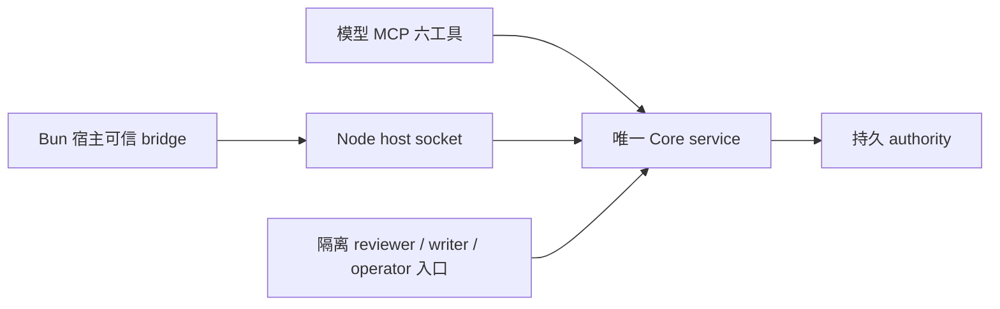

# Design

## Context

来源为 [能力改进提案](../../../../docs/taric-capability-improvement-proposal.md)，冻结评审基线与本次读取的 HEAD 均为 `c3db857e937c04293eb08e258ca98c8e24a2b897`。BreachWeave/CyberStrike 两份推演是需求样本；本次未运行这些宿主，未复跑 benchmark，不据此认证宿主或宣布实现完成。

| 已读取的实现/规格 | 观察结果 | 本次增量 |
|---|---|---|
| `runtime-startup.ts`、`runtime-service.ts`、硬化 delta | CLI/MCP 共用启动；PG 激活已有构建/schema/policy 摘要及只读 readiness | 复用并回归，不重做 resolver 或 PG 治理 |
| `adapter-rpc.ts`、RPC 测试 | 本地 socket、固定 Engagement 的 host principal、1 MiB JSONL 帧；不能切换 reviewer/writer 身份 | 提供非 Node 宿主代理示例 |
| `adapter.ts`、`pi-adapter.ts`、`compatibility.ts`、README | 自定义 ID 类型封闭；descriptor、注册能力与静态报告不一致 | 开放标识，按实例合成能力 |
| Artifact binding 与 `assertFence` | binding 只有 session/root；三项 run 字段全缺时跳过 fence；upload 已保存运行信息 | 持久显式模式，禁止省略降级 |
| `context.ts`、`store.ts`、persistent cursor 测试 | 续页重新 snapshot/hydrate/sort；resume 读两个 snapshot 和全量 events；已有 recordsPage/keyset | 有界查询、固定时间、有限 cursor |
| Artifact profile 和 benchmark 脚本 | 64 MiB decoded、base64 加 16 KiB metadata；无 fsync；基准同进程交错上传 | 保持合同，补真实 transport/资源测量 |
| registry/service、主规格 | snapshot.import 已公开；advanced-context 要求迁移，authority-storage 又明确不支持导入 | 撤销公开导入合同，保留内部恢复验证 |

`harden-taric-authority-runtime` 的 28/28 任务完成但尚未归档，部分合同未同步到主规格。本变更按“主规格 + 已完成硬化 delta”理解基线，保留持久 cursor 密钥、重启/轮换、固定读取、publication marker 等成果，不重新包装为新增交付。本次不修改或归档上一变更；后续同步/归档须先硬化、后本变更，避免旧 delta 覆盖新 Context 合同。

## Goals / Non-Goals

**Goals:** 按 P0 → P1a → P1b → P2 分层交付，每阶段保留可运行产品。采用能力可以减少，身份、隔离、信任和错误约束保持完整。Core 是唯一治理权威；默认持久 SQLite，多主机显式选择并 fail closed。

**Non-Goals:** Bun driver、远程网络监听、MCP Tasks、搜索索引、通用事件重放、宿主状态导入、模型直写、调度/动作授权、原文解析/脱敏、默认 fsync 或后台 worker。不拆包、不新增 batch API、不承诺低于 2 秒、断电耐久或质量统计发布。

## Decisions

### 1. I-01：按依赖闭包交付采用说明

复用 `docs/agent-integration.md` 与中文集成方案，列出 A 只读、B 候选、C 已验证 Finding、D 运行恢复、E 原文内容五闭环的初始化、角色、依赖、调用和结果。A 仍需 operator 初始化与授权；B 的 capture/submit 成功仅为 proposal，admission 后才是 L1；C 使用独立 reviewer 与 Finding 专用 L2 promotion；D 依赖 WorkItem/WorkRun/Attempt/lease/checkpoint；E 显式 session/content_read，允许外部 opaque 引用。

完整示例建立 Engagement/scope、Resource、Observation、Evidence、Claim、Finding 和审核绑定，不把五六个 operation 当初始化清单。对已有 bridge 与仅有模型工具两类宿主记录新增职责、实际工时、调试/调用/人工等待成本，不预填 ROI、人周或等效安全比例。文档明确治理不保证观察真实性、动作授权、目标锁或资产发现完备性。

### 2. I-02：Node 代理复用公开入口

Node 启动器使用 `openRuntimeService`，不复制 resolver/store。示例运行真实 Bun 进程与同机 socket；容器只说明宿主已有通道/socket 挂载责任，不新增 TCP/HTTP。只导出稳定 service/RPC 入口，不公开完整存储接口。

现有 `listenAdapterRpc` 保持 host-only。operator 初始化、writer admission/promotion、reviewer attestation 使用隔离的受信任 Node service client，principal 在可信入口分别注册，身份与审核配置不交给 Bun 的模型工具。模型路径使用受限 MCP；host capture 必须来自实际工具结果，转发模型文字不变成可信观察。各入口共享同一 Core 与 authority 配置。

POC 包含启动/退出/重连、密钥/socket 权限、proposal → L1 → 独立 review → L2 → authority/代理重启后读取，以及 CAS、幂等冲突、stale/quarantine 业务结果。`ok:true` 不等于已接纳。无真实 Bun 环境时证据 pending，不以 Node 模拟替代宿主认证。

验收补充（用户于 2026-10-18 明确）：工程实现工时未单独计量，保留为成本记录缺项，不阻塞任务 4.3 的技术完成。用户另提供费用 `300$`，按自报金额记录，币种、费用范围与计费依据未注明；不得据此倒推工时或宣称实测 ROI。真实进程、重启、幂等、CAS、迟到重试及调用/等待测量的技术验收保持不变。

P1a 代理仅声明元数据与外部 Artifact 引用；原文使用受信任 Node/CLI 内容入口。1 MiB RPC 不承诺上传 64 MiB。P1b 逐一测量声明支持内容的 transport，不强制模型 MCP 或元数据 RPC 承载原文。未来 RPC 内容支持必须使用 Artifact profile、有限缓冲和真实大块证据，不能全局取消帧限制。Bun 原生 driver 仅由代理被证实为采用阻断触发独立立项。

### 3. I-03：可信 session 模式不可由请求降级

将 `host-session`/`run-bound` 模式与绑定归属存入 authority；run-bound 保存 Engagement/session、WorkRun、Attempt、generation、owner 的可信关联。host/operator 建立绑定，模型不能修改。已有 run 绑定不能用请求覆盖成 host-session；更换归属须建立新显式绑定。

Artifact begin 绑定 upload；append/commit 从持久 upload/session 恢复归属并检查当前 owner、Attempt、generation、lease。客户端不必重复传 lease/owner，但服务端不能因请求没有 run 参数跳过 fence。proposal/capture/checkpoint/action 按各自 envelope 与 transport/session 关联核查：所需运行字段缺失或冲突即拒绝，不接受改换未绑定 session 绕过原关联。重启 reconcile/publication 重新验证保存的绑定，过期内容隔离。

非法 envelope 返回 `validation_error`，权限问题 `authorization_error`，旧版本/运行失效保留已有 typed code；迟到 proposal 保留既有 quarantine 结果和可观测归属。校验与权威修改/幂等/outbox 受同一治理边界控制。已提交幂等结果可按原合同返回，但失效重试不能产生新副作用。

选择显式模式而非全局关闭 fence。host-session 只保证认证捕获与内容隔离，不声称 WorkRun 租约保证；服务端不能从文字推断隐藏 worker 身份，宿主仍需如实路由。

### 4. I-04：能力由静态上限与实例事实合成

`compatibility.ts` 保存认证上限与证据，注册结果提供 hook/tool/callback/run binding。合成器结合 principal、profile、backend 当前 readiness、匹配 evidence，输出 implementation、runtime、authorization、certification/evidence 和独立 quality-release 结论。缺质量数据只阻断质量声明，不抹去已验证技术能力；算法或 mock 通过不代表质量发布。

先修 Pi：checkpoint/host-result 需 callback 与有效 run binding，缺一即 unavailable。README、adapter.status、capability.status、接入文档使用同一合成规则生成或检查。自定义 ID 改为格式校验字符串，package/distribution/version/commit 单列；ID 与能力协商不授予权限。未知 patch/fork、第二 Pi 分发不自动认证，不扩大未经测试的 semver 区间。

PG 沿用当前激活链：实现/场景证据 → 当前只读 health/schema/lease 与摘要匹配 → operator 显式 profile。新构建不沿用旧摘要；生产启动不跑写 fixture 的 conformance，失败不创建 SQLite fallback。

### 5. I-05：先测读取，再替换全量续页

扩展 `scripts/benchmark-authority.mjs`，拆分排队、SQL 次数/扫描与返回行数、hydration、排序、投影、序列化、cursor 字节、RSS、event-loop、WAL。保留 10k/50k，增加长历史、高 churn、多 Engagement、并发更新与重启。历史 8.38 秒首屏与三页续页只是旧测量。

复用 `recordsPage` 的 pinned/keyset 思路，在 authority 层增加有界 Context 候选和 Engagement/序列范围事件查询，SQLite/PG 共享外部合同，内部索引不产品化。Context 将强制项与其余排序组分开，固定 read_seq/read_time，下推信任/范围过滤，以稳定键加 ID 续读。扫描有独立预算，不能完成则 continuation/明确错误；保留 scope、blocked、未测覆盖、freshness、omitted_ranges 与补全语义。

resume 按变化 subject 获取固定前后版本，生成状态差分，保留 premise/动作/授权检查；不是 changefeed 或完整事件投递证明。cursor 用持久可轮换密钥绑定 authority、principal、Engagement、sequence/time、policy、filters、ordering、budget、expiry；证明排序单调无重漏后才移除随页数增长的 delivered IDs。不永久缓存 snapshot，不放完整记录进 cursor；旧格式明确 invalid_cursor。

先验证续页行数和 cursor 大小随页大小受限且不重复全量 hydration，再比较同机相同 fixture 的 p50/p95、样本数、峰值。50k 首屏降低至少 50% 为待复测确认的候选目标，未达须记录结果，不能伪称容量/SLA。

### 6. I-06：保留大块与 process-crash 合同

使用现有 Artifact deployment profile：64 MiB decoded、base64 上限 ceil(decoded/3)*4、16 KiB metadata；各内容入口列 decoded/envelope/response/队列限制，不降低 chunk 隐藏成本。普通 RPC 保留 1 MiB 元数据帧界；framing 超限可以断开而无业务响应，Core/CLI 可解析超限返回 typed validation，两者都不得发布。

真实 CLI/受认证内容入口测 1/2 并发、文本/二进制、64 MiB × 2、慢收发、超限；记录客户端与服务端时间、排队、吞吐、RSS、event-loop、watermark、失败/publication。标明同步阶段是否串行，不用两个样本推尾延迟。定位并减少 base64、Buffer、staging copy、hash/JSON 的同时存活和冗余复制，保持 ordered append、原字节 hash、幂等和不可变发布。

扩展 manifest/rename/publication marker/catalog 全故障点、中止、重复提交与重启 reconcile；未验证内容不能 available，恢复须校验当前绑定。默认 local_process_crash、无显式 fsync、无断电耐久不变；fsync profile 需要独立文件系统与性能/故障对照。

维护 operator-only，doctor/verify 只读与 reconcile 修复分开，固定水位并测普通写入排队、heartbeat、event-loop、WAL。优先已有独立 CLI/维护窗口；worker 与独立连接的事务/锁/取消设计由实测触发另立变更。

### 7. I-07：host 状态轮询，测量触发订阅

新增 `host.state` 只读操作，host/operator、Engagement-scoped，模型六工具不增加。一次读取一个授权 Engagement，返回有界待审 L1、Conflict/Impact、unknown action、lease 异常、授权水位与固定读取时间；多 Engagement 由宿主按授权集合分页聚合。不公开 host 队列/原文给模型，不泄漏全局序号或其他 Engagement 存在性。SLA/freshness/lease 到期按读取时间计算，不能只靠 commit。

先交付退避轮询，测量前记录宿主调用/资源成本预算和发现延迟预算。满足预算则以订阅未触发/disabled 完成评估；超预算才进入条件实现，不能先 enabled 再补证据。

若触发 MCP 订阅，独立 host 接入面协商版本并实现 resources list/read/subscribe/unsubscribe；稳定 URI 表示资源，标准 notifications/resources/updated 只带 URI，水位经授权读取取得。遵循 [固定版 Resources 规范](https://modelcontextprotocol.io/specification/2025-11-25/server/resources)。模型 MCP 不因 resources 自动获得 host 权限。[固定版 Tasks 规范](https://modelcontextprotocol.io/specification/2025-11-25/basic/utilities/tasks)标为 experimental，本变更不机械映射 WorkRun/取消/HITL。

读取/投递重新鉴权，撤权/解绑取消订阅；每 principal 的订阅数、资源数、频率、待发字节/socket 队列有限。合并同 URI 脏标记，慢客户端断开回轮询；无逐事件持久队列。注册前后检查水位关闭丢变更窗口，跨进程用有界水位探测，不只监听本进程回调，不抢 outbox consumer。重连先重读，应用完 pinned 范围才推进完成水位，旧位点失效明确重查。通知不触发模型/调度/维护，不逐条写 authority 审计链。

### 8. I-08：撤销公开导入，保留内部恢复验证

保留公开 snapshot.import 名称作为明确 unsupported_capability 拒绝入口，从 supported inventory 移除；CLI、registry、dispatch、文档/测试同步。导出的 Core service snapshotImport 同样拒绝，不能成为绕过。移除 advanced-context 的 Portable authority snapshot migration；authority-storage 只读 export/unsupported import 继续有效。

shared-authority-backend 的 backup/restore 保留为内部后端灾备/隔离 conformance 逻辑，不经公开 service/CLI 变成宿主导入；保留临时目标校验、失败无修改保证。内部恢复可保存 ID/版本，但不是普通创建入口。只读 export 不等于可恢复 payload 的完整备份。

旧材料通过正常 proposal/外部 evidence 引用表达原始时间、材料来源、limitations；source_kind: import 不覆盖 transport provenance，不冒充当前真实工具观察或 L2。

## Risks / Trade-offs

- [额外 Node 进程增加成本] → POC 实记工时、重连和资源，仅证实所测 Bun 版本/拓扑。
- [高 churn 扫描超预算] → 独立扫描上限、continuation，保留强制项与固定读取时间。
- [大 JSON/base64 仍有峰值] → 真实 transport 测峰值并减少复制，不提前启用未测路径。
- [旧 binding/upload 不含可信模式] → 显式失败，不从请求猜测并降级为 host-session。
- [订阅漏发/跨进程变化] → 轮询保持正确，通知后强制授权重读。
- [前后变更都修改 Context] → 先同步硬化再同步本变更，保留场景并严格校验。

## Migration Plan

1. P0 交付依赖、成本、能力矛盾和支持清单，明确现有 conditional fencing 与将撤销的 import 范围。
2. P1a 交付绑定/报告格式、代理和 import 拒绝，每个切片同交测试/文档。旧 cursor/未知 schema/缺绑定显式失败，不保证兼容。operator 备份 authority 与内容根，在副本新环境验证；回退使用旧程序与匹配备份，不让旧程序打开新格式。
3. P1b 先取同机基线，再逐路径替换 Context/Artifact；新摘要重新取证，不沿用旧 PG activation report。单机/显式 memory、多主机 fail-closed 全程回归。
4. P2 交付状态轮询与预算证据；未触发订阅以 disabled 结论完成，触发则通过协议/授权/背压/重连测试后启用。
5. 发布用独立干净构建、真实隔离场景与当前 live gate，保存构建/schema/policy 摘要、版本、机器/fixture、命令、样本数、原始/故障结果、未验证范围。技术与质量结论分开，不能靠 callback 返回 evidence 字符串证明真实测试通过。

## Acceptance Traceability

| 来源 | 落实位置 | 验收 |
|---|---|---|
| I-01 | Decision 1；tasks §1/§4 | T02/T03/T06：五闭环、POC 成本、L1/L2 结果 |
| I-02 | Decision 2；host-adapters；tasks §4 | T01/T02/T03/T06：真实 Bun、分离身份、重启 |
| I-03 | Decision 3；collaboration；tasks §2 | T04：全部/部分省略、错 owner、旧 generation、lease、恢复发布 |
| I-04 | Decision 4；host-adapters；tasks §3 | T05/T12：缺绑定、自定义 ID、未知版本、旧证据、质量分列 |
| I-05 | Decision 5；Context/authority；tasks §5 | T07/T08：10k/50k、churn、多 Engagement、cursor 篡改/过期/重启/轮换 |
| I-06 | Decision 6；Artifact/authority；tasks §6 | T09/T10/T11：真实 64 MiB × 2、故障、维护并发 |
| I-07 | Decision 7；runtime API；tasks §7 | T13：时间到期、跨进程轮询，触发后测撤权/漏通知/慢消费 |
| I-08 | Decision 8；Context/runtime；tasks §2 | T14：公开 import 无副作用拒绝，旧材料正常治理 |

T01–T14 的详细输入/通过条件以来源提案 §17 为验收基线；上表只指定落实位置，不声称测试已执行。
